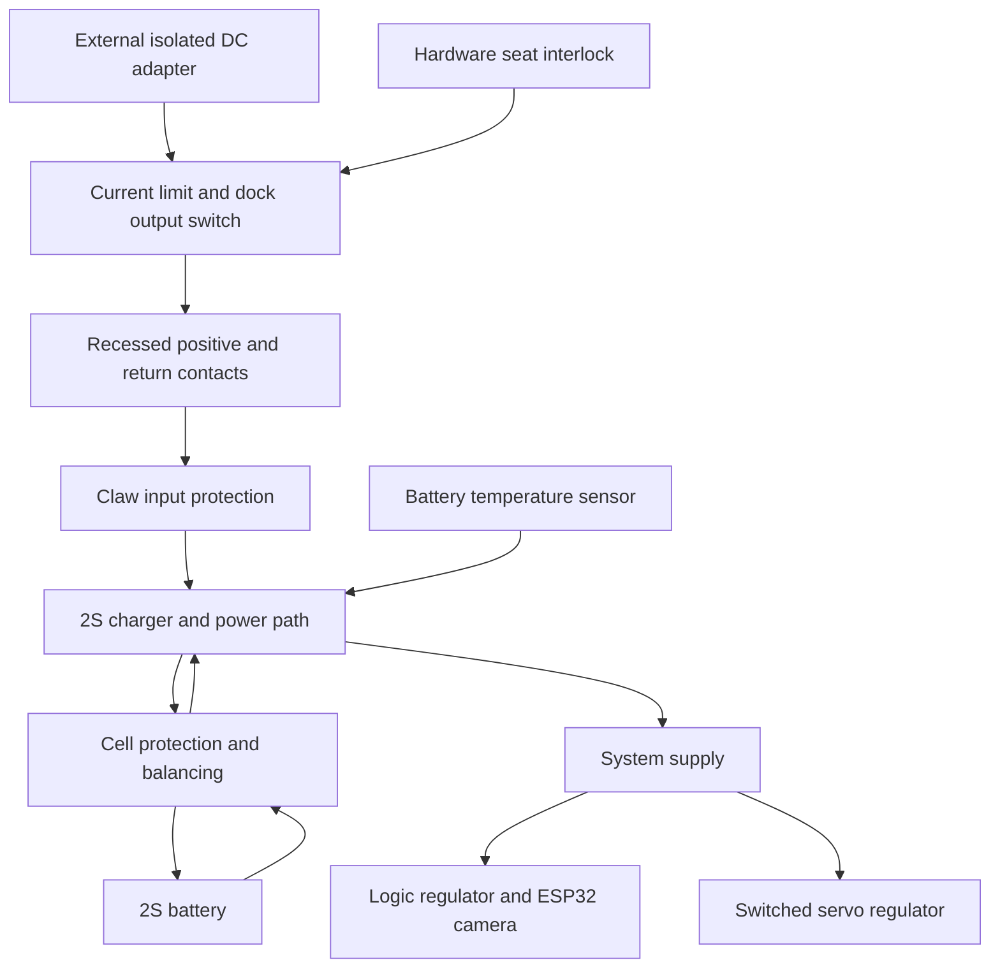

# Claw dock charging — electrical Rev B concept

Requirement discussed 2026-10-12; recorded 2026-10-14. Status: proposed architecture, not an assembly-ready schematic. Rev A remains the manual-charge bench circuit. No charging hardware has been purchased or validated by this document.

## Proposed arrangement

Use an external isolated low-voltage adapter at the wall. A fused/current-limited, normally off dock output feeds recessed compliant contacts. Plastic guides and the structural hook support and align the claw; contacts carry current only. On the claw, reverse-current/polarity protection feeds a qualified 2S charger and system power-path assembly. That assembly supplies the logic regulator while charging the battery; the servo branch is switched off during charging. Battery-side protection must monitor both cells and include appropriate balancing and temperature supervision.

This is a functional block diagram. A selected module may combine blocks; its actual battery, protected-pack and system terminals govern wiring. Do not connect raw battery taps to common ground in a way that bypasses protection FETs. All battery cell taps stay inside the claw under this proposal. Two power contacts are sufficient in principle; additional detection contacts or a local mechanical switch may be needed. Contact size, spacing, travel, ratings and final count are not frozen.

The earlier suggestion was to investigate wall-side charging first to reduce suspended mass. Onboard charging is now recommended for evaluation because it avoids carrying individual cell connections through the moving dock interface and simplifies contact guarding. Tradeoff: extra electronics, heat and volume in the claw. This is an engineering recommendation, not a user-approved purchased configuration.

## Charger, protection and power path are different functions

- Charger: controlled current/voltage charging to the selected pack's specified limits (normally 8.4 V for conventional 2S LiPo).
- Cell protection and balancing: prevent an individual cell exceeding its permitted range; manage imbalance and pack faults. A protection board is not itself a charger.
- Power path: supplies the running controller separately from the measured battery charging current so system load does not defeat charge termination. Do not simply parallel the live robot across a generic charger output.

TI BQ25887 is an example of a 5 V-input 2S charger with balancing, but it is not assumed to provide the complete system power path. BQ25798 is an example supporting power path, but its product specification does not establish integrated cell balancing. Neither bare IC is a ready-to-wire purchase recommendation. A bare 8.4 V boost converter and the XIAO's single-cell battery charger are unsuitable substitutes for a complete 2S charging solution.

## Dock state sequence

Approach slowly → mechanically seat and support the claw → confirm stable seating → disable servo power → enable dock input → verify charging status and temperature. Stop charge and verify battery/system power transfer before lifting off. A hardware interlock and current limit must work independently of Wi-Fi; startup from a depleted pack must not require already-running ESP32 firmware. Open contacts must not be back-powered from the battery. Recesses reduce accidental contact but do not make a conductive-debris short impossible.

## Open design gates

1. Exact battery model, cell limits, connector, and whether protection is included.
2. Qualified charger/power-path module and compatible per-cell protection/balancing topology.
3. Adapter voltage/current, charge rate, fuses and wiring based on selected hardware.
4. Hardware detection, input gating, reverse-current protection and fault behavior.
5. PCB envelopes, temperature sensor placement, contact qualification and housing thermal testing.
6. Manual docking tests before autonomous approach; no unattended charge qualification exists yet.

Primary sources checked 2026-10-12: https://www.ti.com/product/BQ25887 and https://www.ti.com/product/BQ25798 .
