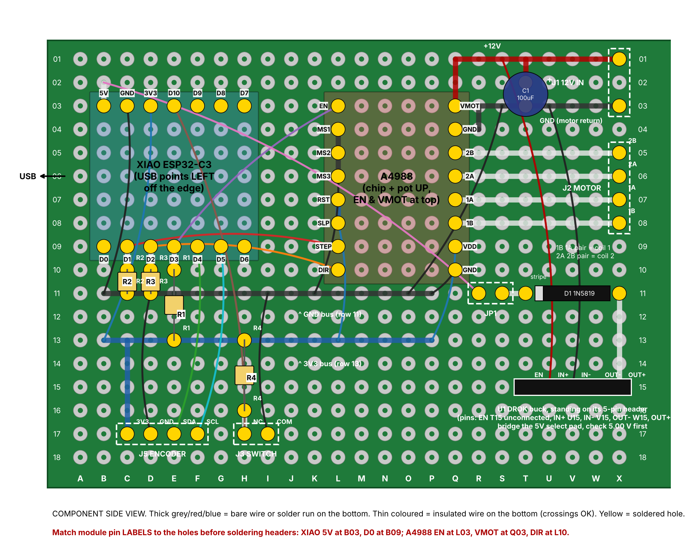

# Station perfboard layout (Rev D, 5x7 cm board)

Component-side view. Holes are named column letter + row number as printed on
the board (A-X, 01-18). Generated and net-checked by `perfboard_layout.py`
(every hole has exactly one net; every net is connected).

## Placement
| Part | Holes |
|---|---|
| XIAO ESP32-C3 (female headers), USB off the LEFT edge | top row B03 5V, C03 GND, D03 3V3, E03 D10, F03-H03 unused; bottom row B09 D0, C09 D1, D09 D2, E09 D3, F09 D4, G09 D5, H09 D6 |
| A4988 (female headers), chip + pot up | L03 EN, L04 MS1, L05 MS2, L06 MS3, L07 RST, L08 SLP, L09 STEP, L10 DIR; Q03 VMOT, Q04 GND, Q05 2B, Q06 2A, Q07 1A, Q08 1B, Q09 VDD, Q10 GND |
| J1 12 V in (5.08 mm terminal or wires) | X01 +12, X03 GND |
| J2 motor (4-pin) | X05 2B, X06 2A, X07 1A, X08 1B |
| J5 encoder (4-pin) | C17 3V3, D17 GND, E17 SDA, F17 SCL |
| J3 switch (2-pin) | H17 NC, I17 COM |
| U1 DROK buck (5-pin single-row header OUT+, OUT-, IN-, IN+, EN), standing upright | X15 OUT+, W15 OUT-, V15 IN-, U15 IN+, T15 EN (no connection). Select 5 V by bridging its "5V" pad; check 5.00 V before connecting loads |
| JP1 link (2-pin + jumper) | R11 (XIAO 5V side), S11 (diode side) |
| D1 1N5819 (lying) | stripe/cathode T11, anode X11 |
| C1 100 uF/50 V | + T02, - T03 |
| R1 10k (EN pull-up) | E10 - E13 |
| R2 10k (STEP pull-down) | C10 - C11 |
| R3 10k (DIR pull-down) | D10 - D11 |
| R4 10k (switch pull-up) | H13 - H16 |

## Bare runs (bottom)
- 5V: B02-B03. JP1 to diode: S11-T11. Diode anode to buck OUT+: X11 down to X15. Buck OUT- and IN-: V15-W15.
- +12 V: Q01 to X01 along row 01; Q01-Q02-Q03 (VMOT); T01-T02 (C1 +).
- Motor return GND: R03 to X03 along row 03; R03-R04; Q04-R04.
- Motor: rows 05-08 from Q to X.
- C09-C10, D09-D10, E09-E10 (resistor tie-ins).
- GND bus: row 11, B11 to P11. 3V3 bus: row 13, B13 to P13. Encoder 3V3: C13 to C17.
- L07-L08 (RST+SLP). L04-L05-L06 (MS1-3). H16-H17.

## Insulated wires (bottom)
| From | To | Net |
|---|---|---|
| C09 | L09 | STEP |
| D09 | L10 | DIR |
| E09 | L03 | EN |
| F09 | E17 | SDA |
| G09 | F17 | SCL |
| E03 | H17 | D10 / switch NC |
| C03 | B11 | XIAO GND |
| D03 | B13 | XIAO 3V3 |
| Q09 | P13 | A4988 VDD |
| Q10 | P11 | A4988 logic GND |
| L08 | L13 | RST/SLP to 3V3 |
| L06 | K11 | MS1-3 to GND |
| D17 | D11 | encoder GND |
| I17 | I11 | switch COM |
| S03 | O11 | ties motor GND to logic GND |
| B02 | R11 | XIAO 5V to JP1 |
| S01 | U15 | +12 V to buck IN+ |
| U03 | V15 | GND to buck IN-/OUT- |
