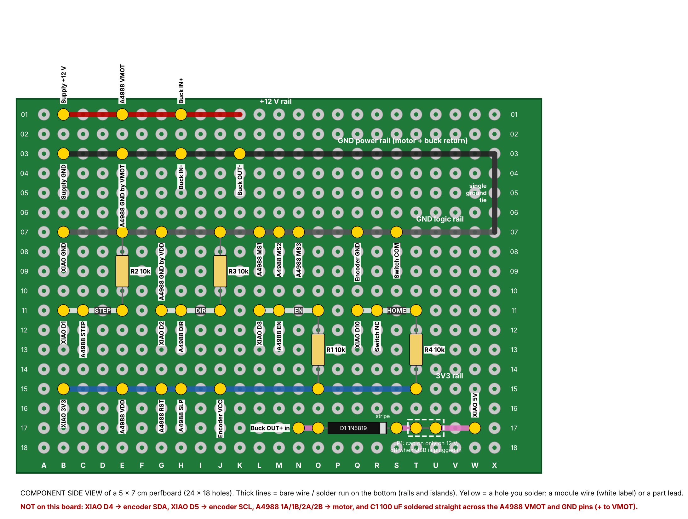

# Station junction ("rail") board (Rev D, 5 x 7 cm perfboard)

For a station built with **separate modules** (XIAO ESP32-C3, A4988 carrier, buck converter), wired with hookup wire
to one small 5 x 7 cm perfboard. The board only joins the rails, and carries the four pull resistors, the 5 V diode and
the JP1 link. The connectivity is identical to the soldered Rev D board: `rail_board_layout.py` checks every wire
against `perfboard_layout.py`, and the check catches wrong-net, wrong-hole and missing-wire errors.

Holes are named column letter + row number. Hold the board landscape: columns A-X along the long edge, rows 01-18 down.

## Rails and islands (bare tinned wire on the bottom)

| Run | Net | Wires that land on it |
|---|---|---|
| row 01, B-K | +12 V | B01 supply +12 V, E01 A4988 VMOT, H01 buck IN+ |
| row 03, B-X | GND power | B03 supply GND, E03 A4988 GND (the one by VMOT), H03 buck IN-, K03 buck OUT- |
| column X, 03-07 | ground tie | joins the two ground rails at this one point |
| row 07, B-X | GND logic | B07 XIAO GND, G07 A4988 GND (the one by VDD), L07/M07/N07 A4988 MS1/MS2/MS3, Q07 encoder GND, S07 switch COM |
| row 11, B-E | STEP | B11 XIAO D1, C11 A4988 STEP |
| row 11, G-J | DIR | G11 XIAO D2, H11 A4988 DIR |
| row 11, L-O | EN | L11 XIAO D3, M11 A4988 EN |
| row 11, Q-T | HOME | Q11 XIAO D10, R11 switch NC |
| row 15, B-T | 3V3 | B15 XIAO 3V3, E15 A4988 VDD, G15 A4988 RST, H15 A4988 SLP, J15 encoder VCC |
| row 17, N-O | 5 V from buck | N17 buck OUT+ |
| row 17, S-T | after diode | (D1 stripe, JP1) |
| row 17, U-W | XIAO 5 V | W17 XIAO 5V |

Keep the four row-11 islands separate: F11, K11 and P11 stay empty.

## Parts on the board

| Part | Holes |
|---|---|
| R2 10k (STEP pull-down) | E11 - E07 |
| R3 10k (DIR pull-down) | J11 - J07 |
| R1 10k (EN pull-up) | O11 - O15 |
| R4 10k (HOME pull-up) | T11 - T15 |
| D1 1N5819 | anode O17, stripe (cathode) S17 |
| JP1 2-pin header + jumper cap | T17 - U17 (cap on only when running from 12 V with USB unplugged) |

## Direct wires (not on this board)

- XIAO D4 -> encoder SDA; XIAO D5 -> encoder SCL.
- A4988 1A, 1B, 2A, 2B -> motor. 1A-1B is one coil, 2A-2B the other; check with a meter, a few ohms each.
- **C1 100 uF / 50 V straight across the A4988 VMOT and GND pins (the GND by VMOT), + to VMOT, legs as short as
  possible.** It must sit at the driver, not on the rail board.

Wire: 22 AWG or thicker for 12 V, power GND and the motor; anything for logic.

## Bring-up (same as the soldered board)

1. Meter on continuity: no short from 12 V to GND, and none from 3V3 to GND.
2. Connect only the supply, the buck and D1, with JP1 off. Set the buck to 5.00 V (meter on N17).
3. Add the XIAO (on USB, JP1 off) and the A4988, motor unplugged. Check 3.3 V on row 15.
4. Set Vref to about 0.85 V (pot maximum), which is about 1.06 A.
5. Power off, plug in the motor, power on. Never plug or unplug the motor with power on.
