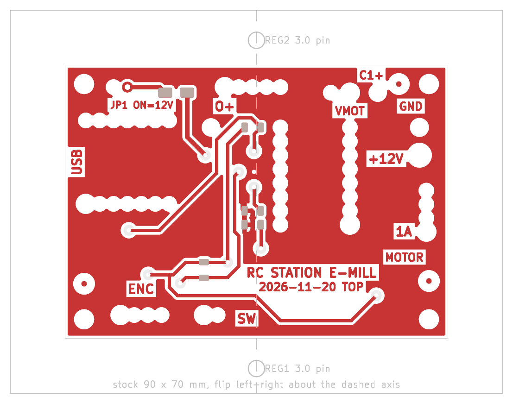
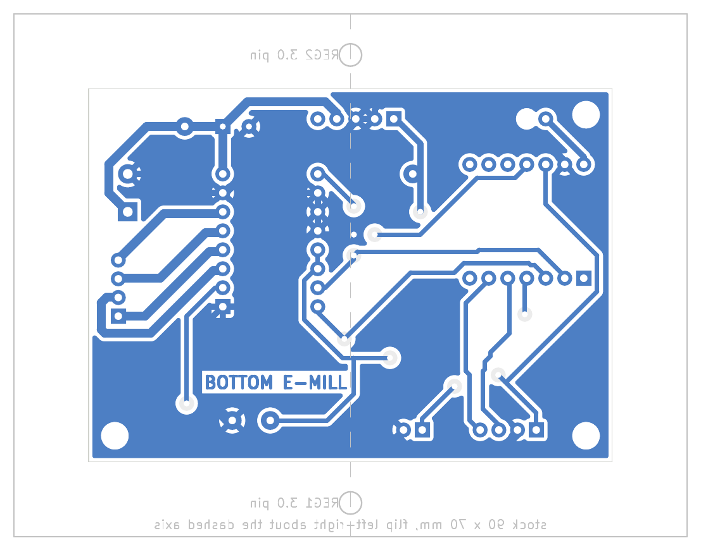

# RoomCleaner Station Rev E, mill variant: double-sided board milled in-house on the Fab Lab Carvera

**Same circuit, same parts and same placement as Rev E (`../station_revE_pcb_20261029/`), re-laid out
so that it can be milled from double-sided FR4 (copper / insulator / copper) on the lab's Makera Carvera.
There is no through-hole plating, so every via becomes a soldered wire and every through-hole pin connects
only on the side it is soldered on.** SMD parts still go through the lab's stencil → NeoDen YY1 → DDM
Novastar flow; the rest is hand-soldered at the bench.

## Why this variant exists

Rev E is laid out for a board house: plated vias, copper on both sides of every through-hole pin, 51
stitching vias, solder mask. A milled board has none of that. Without plating:

* a via is only a hole: it connects top and bottom only after a wire (or a via rivet) is soldered on both
  sides;
* a pin of a female header, JST-XH connector, screw terminal or C1 connects only where it is soldered.
  Their bodies sit flush on the top, so they can only be soldered on the bottom.

This variant makes every through-hole pad single-sided (bottom copper only), keeps the SMD parts on top,
and joins the two with as few wire vias as the routing allows. Use it if the lab approves FR4 on the
Carvera and a board is wanted faster than a board-house order. The Rev E board-house files stay the
reference for a production run.




Renders: top = F.Cu + paste, bottom = B.Cu seen from below; both with the outline, the 90 x 70 mm stock and
the two registration pins (grey). On the top render the round white areas are the copper-free keep-outs
over the bottom-only pins (the pins pass through bare FR4 on the top side). No silkscreen or mask: the
milled board has none.

## Files

| File | What |
|---|---|
| `RoomCleaner_Station_RevE_mill.zip` | **for the lab's CAM step**: `_F_Cu.gbr`, `_B_Cu.gbr`, `_Edge_Cuts.gbr`, `_F_Paste.gbr` (stencil, SMD pads only), `_ALL-NPTH.drl` (one Excellon file, every hole, all non-plated, including the two 3.0 mm registration-pin holes), `_Registration_User_Drawings.gbr` (stock rectangle, flip axis, pins; reference only). All files share one origin: **the lower-left board corner, X right, Y up, mm**. |
| `RoomCleaner_Station_RevE_mill_pos.csv` | YY1 placement, top, SMD only, mm, same origin (`kicad-cli pcb export pos --side front --smd-only --use-drill-file-origin`). R1-R4, D1, plus FID1-FID3 rows (fiducials, not parts). |
| `RoomCleaner_Station_RevE_mill_F.Cu_mirrored_1to1.pdf`, `_B.Cu_mirrored_1to1.pdf` | fallback 1:1 copper artwork (A4, black on white, with outline, stock and pin marks), each in the orientation for a face-down transfer (toner transfer / photo-resist film): F.Cu mirrored; B.Cu in top view, which is the mirror image of the bottom as seen from below. Print at 100 % ("actual size") and check 70.0 x 50.0 mm on the outline. |
| `RoomCleaner_Station_RevE_mill_top.png`, `_bottom.png` | renders (above) |
| `RoomCleaner_Station_RevE_mill.kicad_pro/.kicad_pcb/.kicad_prl`, `fp-lib-table`, `RoomCleanerRevEMill.pretty/` | KiCad 7 project; generated footprints with single-sided pads |
| `RoomCleaner_Station_RevE_mill_BOM.csv` | BOM (same parts as Rev E) + 11 wire vias |
| `RoomCleaner_Station_RevE_mill_drc.rpt` | KiCad DRC: **0 violations, 0 unconnected** |
| `netlist_check.txt` | geometric net check vs Rev D: **PASS** |
| `mill_check.txt` | top-copper check, mill rules, wire-via list: **PASS** |
| `build_pcb_revE_mill.py` | builds everything from the Rev D nets, re-using the Rev E generator and router by import |
| `check_pcb_revE_mill.py` | runs the Rev E net checker on this board + the mill checks |
| `routing_mill.json` | cached router result |

```
cd docs/electrical/station_revE_mill_20261120
/usr/bin/python3.12 build_pcb_revE_mill.py             # board, DRC, exports (re-uses routing_mill.json)
/usr/bin/python3.12 build_pcb_revE_mill.py --reroute   # route again (about 5 min)
/usr/bin/python3.12 check_pcb_revE_mill.py             # net check + mill checks
```
(`python3.12`: KiCad 7.0.11's `pcbnew` module is built for it on this machine.)

## Results

* **KiCad DRC (7.0.11): 0 violations, 0 unconnected pads.** Rules in the project: clearance 0.4 mm
  (0.5 mm for power, 5 V and GND classes), 0.5 mm to the board edge, keep-outs over single-sided pins.
* **Net check: PASS.** The Rev E checker (imported unchanged) joins copper by geometry; a pad joins
  only the copper layer it is on, a via joins both layers (the soldered wire). 16 copper islands = the 16
  Rev D nets, pin for pin; the 6 open Rev D pins touch nothing; no shorts. Mutation tests: removing one
  HOME wire via gives "HOME split into 2 copper islands", FAIL; a top track onto XIAO pin 5 is caught by
  the top-copper check, FAIL.
* **Top-copper check: PASS.** No F.Cu copper (track, via pad, SMD pad, pour, copper text) comes within
  0.4 mm of any pad of J1, J2, J3, J5, U1, U2, U3 or C1, or of the other bottom-only pads (JP1 pin 2,
  TP1-TP4); none of those pads has top copper. Closest: 0.44 mm (top GND pour to J1 pin 1). Mirrored check
  for the one top-only pad (JP1 pin 1): no bottom copper within 0.4 mm.
* **Wire vias: 11** (0 stitching vias). See "Rules not met".
* Mill rules: tracks 1.2 mm (+12V/VMOT, coils), 0.8 mm (5VB, 5VD, +5V, GND), 0.6 mm (signals, +3V3);
  drills 0.8 / 1.0 / 1.3 mm, 3.2 mm M3 holes, 3.0 mm registration holes; THT pads 2.0 mm (terminal
  2.6 mm, test pads 2.5 mm), annular ring ≥ 0.5 mm; wire vias 2.0 mm pads / 0.8 mm drill, every via pad
  ≥ 2.0 mm from every part body (courtyard). GND pour on both layers: 0.5 mm clearance, 0.6 mm minimum
  width, 0.8 mm thermal spokes, islands removed. 789 mm of track.

## Wire vias (W1-W11)

Coordinates in mm. "Top" = from the top-left board corner, y down (KiCad view). "File" = Gerber/drill
origin (lower-left corner, Y up). On the flipped stock (side 2) the same hole is at X' = 70 − X.

| Via | Net | x, y (top) | X, Y (file) | Nearest part body |
|---|---|---|---|---|
| W1 | +3V3 | 15.24, 38.35 | 15.24, 11.65 | J5, 3.5 mm |
| W2 | +3V3 | 29.72, 36.07 | 29.72, 13.93 | R4, 2.2 mm |
| W3 | +3V3 | 56.90, 42.16 | 56.90, 7.84 | TP4, 3.2 mm |
| W4 | 5VB | 25.65, 16.51 | 25.65, 33.49 | TP2, 2.2 mm |
| W5 | DIR | 35.81, 33.53 | 35.81, 16.47 | U3 socket, 2.1 mm |
| W6 | EN | 11.68, 30.23 | 11.68, 19.77 | U2 socket, 2.2 mm |
| W7 | EN | 34.54, 15.75 | 34.54, 34.25 | U3 socket, 2.05 mm |
| W8 | GND | 34.54, 19.56 | 34.54, 30.44 | U3 socket, 2.05 mm |
| W9 | HOME | 21.08, 39.88 | 21.08, 10.12 | J5, 2.0 mm |
| W10 | HOME | 31.75, 19.56 | 31.75, 30.44 | U3 socket, 4.8 mm |
| W11 | STEP | 34.54, 22.35 | 34.54, 27.65 | U3 socket, 2.05 mm |

The distances are pad edge to courtyard; the plug-in modules count as part bodies over their whole
outline, so no via sits under the XIAO or the A4988 (`mill_check.txt` is the generated version of this table).

## Rules not met, and design changes forced by the mill rules

**Via count: 11, target was ≤ 6. The target cannot be met with this circuit and these rules.** Every
SMD pad is on top and every through-hole pad is on the bottom, so each net that touches an SMD part needs
at least one wire via. Those nets are +3V3 (R1, R4), EN (R1), STEP (R2), DIR (R3), HOME (R4), GND (R2,
R3), 5VB and 5VD (D1): 8 nets. The JP1 exception below takes 5VD off that list, so **the floor is 7**.
The other 4 come from crossings the bottom layer cannot make. The router lets each crossing go over the top
through an SMD net's top-side copper, which costs 1 via. A plain jumper would cost 2:

* EN (W6 + W7): the XIAO's EN pin lies on the far side of its STEP/DIR pins from the A4988's EN pin, at
  the top of the A4988 logic column;
* HOME (W9 + W10): XIAO D10 is on the module's top pin row and has to cross the XIAO → A4988 signal bundle
  to reach J3 at the bottom edge;
* +3V3 (W1-W3): 3V3 goes to J5 at the bottom left, to R1/R4 and to the A4988 VDD pin on the motor side.
  The VDD pin sits between the coil and GND pins, and the 1A/1B coil pair has to cross (A4988 order
  2B 2A 1A 1B vs. J2 order 2B 2A 1B 1A).

Several router settings were tried: via price 220/500 grid cells, other net orders, vias under the
modules allowed or not, test-pad moves, and a greedy rip-up pass after routing. The result never went
below 11. Fewer vias would need a different placement (for example the A4988 turned 90°, or J3 and J5
swapped together with a new connector pinout) or connector pins soldered on top. Both change Rev E
decisions, so they are left to the lead.

Changes vs Rev E (placement, values and nets unchanged):

1. **Every THT pad single-sided.** Sockets, JST-XH, terminal, C1, test pads, JP1 pin 2: B.Cu only.
   Each one has an F.Cu keep-out of pad radius + 0.45 mm (no track, via or pour). The whole board was
   re-routed for this. Rev E routed freely on both layers.
2. **JP1 pin 1 is the one documented exception: top copper only.** It is the D1-cathode side (5VD), and
   D1 is on top, so 5VD needs no via. A 2-pin male header can be soldered on top: slide its plastic
   spacer up the pins about 2 mm before soldering. The pad is round now (Rev E: square pin-1 pad), with a
   0.45 mm bottom keep-out. Pin 2 (+5V) is soldered on the bottom as usual.
3. **Vias: 7 plated 1.0/0.5 mm routing vias + 51 stitching vias → 11 wire vias 2.0/0.8 mm, no
   stitching.** The top GND pour connects through W8 and the R2/R3 GND pads only.
4. **Test pads TP1-TP4 are bottom-only**: probe them from below.
5. GND pour: thermal spokes 0.6 → 0.8 mm, minimum pour width 0.5 → 0.6 mm (easier to mill).
6. **Copper labels added** (top: +12V, GND, VMOT, C1+, O+, JP1 ON=12V, USB, ENC, SW, MOTOR, 1A, board
   name and date; bottom: "BOTTOM E-MILL", which reads correctly from below). Strokes 0.35-0.4 mm, 1.2-1.6 mm
   high: a 0.2 mm V-bit can cut them. They are cosmetic, so if the CAM drops a letter, nothing
   breaks. The silkscreen of Rev E stays in the KiCad file as documentation only.
7. Outputs: no mask or silkscreen Gerbers; one non-plated drill file instead of PTH + NPTH; registration
   holes added (drill file only, outside the board outline).
8. Fiducials FID1-FID3 kept: bare 1 mm copper dots with a 1.5 mm copper-free ring, for the stencil and
   the YY1.

## Carvera workflow (lab CAM step)

**Before anything: lab staff must confirm** (1) that FR4 is approved on the Carvera (the lab docs list
FR4 / composites as pending; glass-fibre dust needs the dust shoe / vacuum, no compressed air, and a mask
when cleaning up), (2) which bits they stock and allow for PCB work, and (3) the smallest trace and gap
they can hold. **This design needs: trace ≥ 0.6 mm, gap ≥ 0.4 mm (0.5 mm around power), drills 0.8 / 1.0 /
1.3 mm, 3.0 and 3.2 mm holes, and a 70 x 50 mm outline cut.**

1. Hand the zip to the staff member doing CAM. The lab's CAM is Fusion 360 (Manufacture). There is no
   Gerber-to-toolpath tool in this repository (no FlatCAM-style output), so turning the Gerbers into
   toolpaths is **the lab's own CAM step**. It needs: isolation of `F_Cu`, isolation of `B_Cu`
   (mirrored, see below), drilling from `ALL-NPTH.drl` sorted by tool, and the profile from `Edge_Cuts`.
   If their Fusion path takes DXF better than Gerber, KiCad exports DXF from the same project:
   `kicad-cli pcb export dxf -l F.Cu,Edge.Cuts --ou mm -o F_Cu.dxf RoomCleaner_Station_RevE_mill.kicad_pcb`
   (same for `B.Cu`). KiCad 7's DXF keeps KiCad's page coordinates, so re-zero it on the lower-left corner
   of the outline (it is in the same DXF). Every job must use that corner as its origin.
2. Suggested tools (staff decide): isolation with a 0.2 mm 30° V-bit or a ≤ 0.4 mm end mill (the
   narrowest gap is 0.4 mm); 0.8 / 1.0 / 1.3 mm drills; 3.0 and 3.2 mm holes helically milled with a
   1-2 mm end mill or drilled; profile with a 1.5-3.175 mm end mill, with 2-4 tabs. Clearing the copper
   between isolation passes is not needed: the pours are GND or floating.
3. Use the Carvera's surface probing (Z / height map) on the copper before isolation, if staff use it:
   the isolation depth on FR4 is shallow, and boards are rarely flat.

## Two-sided registration (flip and pins)

Stock 90 x 70 mm, the board centred in it: in file coordinates the stock runs from (−10, −10) to
(80, 60). Two 3.0 mm registration-pin holes lie on the flip axis X = 35 (the board's vertical centre
line), outside the board:

| Pin | X, Y (file) |
|---|---|
| REG1 | 35.0, −5.5 |
| REG2 | 35.0, 54.5 |

1. Fix a sacrificial spoilboard (MDF) to the bed and face it. Fix the stock with double-sided tape
   (or clamps outside the stock). Set the work XY zero at the lower-left board corner, 10 mm in from the
   stock's lower-left corner. **Do not change the spoilboard or the XY zero until both sides are done.**
2. **Side 1 = top (F.Cu) up:** drill every hole from `ALL-NPTH.drl`. Drill REG1 and REG2 through the
   stock and about 3 mm into the spoilboard. Then isolate F.Cu.
3. Lift the stock off and **flip it left-right** (turn it over about the vertical line X = 35). Push two
   3.0 mm dowel pins (or 3.0 mm drill shanks) through REG1/REG2 into the spoilboard holes and tape the
   stock down again. The pins are not symmetric top-to-bottom (5.5 mm below the board, 4.5 mm above), so
   a wrong flip (top-to-bottom) leaves both holes 1 mm off and the stock will not go onto the pins.
4. **Side 2 = bottom (B.Cu) up:** use the B.Cu job mirrored about X = 35 in the same zero (X' = 70 − X,
   Y unchanged); the pins map onto themselves. Before cutting, jog to one via (e.g. W8 at X' = 35.46,
   Y = 30.44) and check that the tool sits centred on the drilled hole. Then isolate B.Cu.
5. Cut the profile last, from side 2 (the outline is symmetric, mirrored or not), and break the tabs.
   Pads are 2.0 mm on 0.8-1.3 mm holes: registration within about ±0.3 mm still leaves a usable ring.

## Assembly order

1. **Mill and drill** (above).
2. **Clean**: deburr both sides (fine abrasive pad), wash with IPA, let dry. Look for copper slivers under
   a magnifier. Fluke on continuity (bottom side): TP1 (12V), TP2 (5V) and TP3 (3V3) to TP4 (GND) must
   be open. Also check the motor coil tracks against each other.
3. **Wire vias W1-W11**: a short piece of 0.6-0.7 mm bare tinned copper wire (a resistor lead works)
   or a 0.8 mm via rivet in each 0.8 mm hole. Solder top and bottom, then trim flush. **On top, keep each
   joint low (file it flat, ≤ 0.3 mm)**: W2, W4, W5, W7, W8 and W11 sit 2.05-2.2 mm from R2/R3/R4/TP2 and
   the stencil has to lie flat around them. Check each via end to end with the meter (0 Ω top pad to
   bottom pad). If the stencil does not lie flat, solder the vias after reflow instead (they are ≥ 2 mm
   from every part).
4. **Stencil + SMD + reflow** (top): stencil from `F_Paste.gbr` (10 pads: R1-R4 1206, D1 SMA). It can be
   cut in the lab if staff have a film-stencil process, or ordered. Bare copper oxidises: wipe the pads
   with IPA just before printing, SAC305 paste. YY1: `RoomCleaner_Station_RevE_mill_pos.csv`, the same
   origin as the Gerbers, fiducials FID1-FID3; two feeders (10k 1206, SS14 SMA). **D1: the cathode band
   goes to pad 1, toward JP1.** Reflow with the lab's SAC305 profile on the Novastar. The via joints melt
   again, so check them after reflow.
5. **JP1** (the top-soldered exception): slide the black spacer about 2 mm up the pins, insert from the
   top, solder **pin 1 on the top** (the pad with the track from D1) and **pin 2 on the bottom**. Leave the
   spacer where it stops.
6. **THT on the bottom only**, lowest first: C1 (100 µF; "+" is the square pad, copper label "C1+"),
   female headers U1 1x5, U2 2 x 1x7, U3 2 x 1x8, JST-XH J5, J3, J2, terminal J1. Every pin is soldered
   **only on the bottom**: the top side of these pins is bare FR4 on purpose. Seat each header pair with
   its module plugged in. **Do not solder any module.**

## First power-up (Kungber SPS3010, Fluke 17B+)

Same as Rev E, with the test pads probed from below:

1. **No modules, JP1 jumper OFF, no motor.** Ohms: TP1 (12V) to TP4 (GND) is not a short; TP2 (5V) and
   TP3 (3V3) to TP4 are not shorts.
2. Supply **12.0 V, 0.3 A current limit**, output off. J1: red to "+12V", black to "GND". Output on:
   about 0 mA; TP1 to TP4 reads 12.0 V.
3. Output off, **plug in the DROK buck** (O+ at the "O+" label). Output on: TP2 reads 5.00 V. Trim to 5.00 V
   before anything else is plugged in. Output off.
4. **Plug in the XIAO** (USB-C at the left edge, "USB" label). For 12 V operation **JP1 ON**; with a USB
   cable in the XIAO, **JP1 OFF**. Output on: TP3 reads 3.3 V; the current stays well under 0.3 A.
5. Output off. **Motor to J2 first, then the A4988**, with its VMOT pin at the "VMOT" label (top right of
   the socket). Output on, still at 0.3 A. The firmware holds EN high until armed, so the current stays
   low. Set Vref per DECISIONS D37 (1.5 A). **Raise the limit to 2 A only once the idle current looks
   normal.**
6. **Never unplug the motor or the A4988 with power on.** If anything reads wrong, check the wire vias
   first (W1-W11, table above). A via soldered on one side only behaves like an open circuit.

## How it was made

`build_pcb_revE_mill.py` imports the Rev E generator (`build_pcb_revE.py`) and its router
(`pathfinder.py`, `maze_router.py`) read-only, and redirects their output folder to this one. The circuit
comes from Rev D's `perfboard_data.py` as in Rev E. On top of Rev E it adds: footprints with B.Cu-only
pads (JP1 pin 1 F.Cu-only); router pins restricted to their pad's layer; obstacles on the other layer
over every single-sided pin; a via price of 500 grid cells; via sites limited to ≥ 2 mm pad-edge distance
from every courtyard and clear of the M3 screw heads; F.Cu/B.Cu keep-out rule areas; copper text; and its
own Excellon writer. The writer is cross-checked against KiCad's drill export for every board hole, then
the registration pins are added. The renders are flat plots (kicad-cli PDF → pdftoppm), not 3D views.
No external routing or CAM tools were used.
