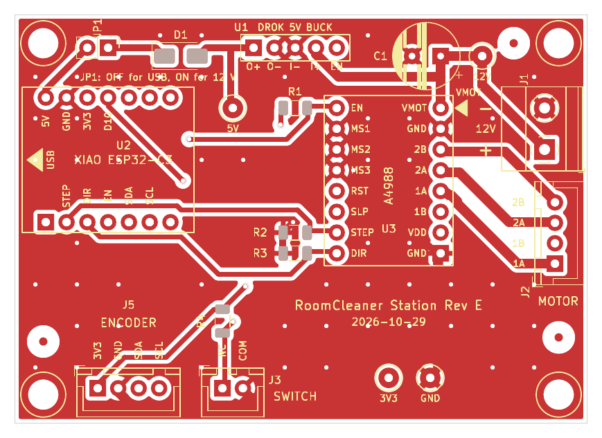
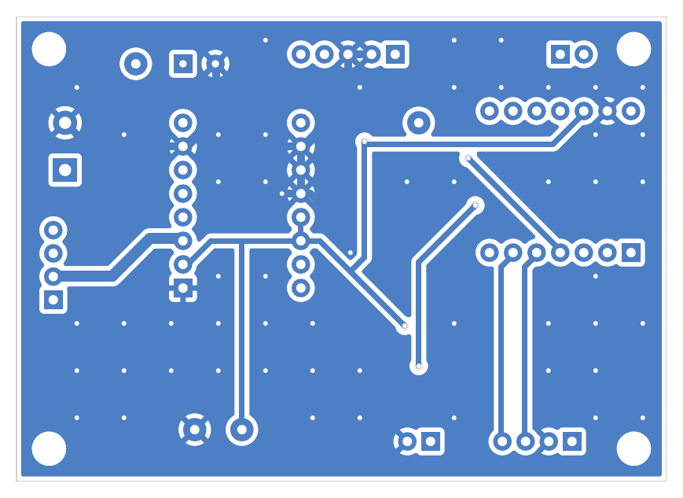

# RoomCleaner Station Rev E (plug-in carrier): PCB for automated assembly

**Order the bare board and its stencil from a board house (JLCPCB-style: 2 layers, 1.6 mm FR4, 1 oz, HASL
lead-free). Assemble the SMD parts on the Fab Lab's line (NeoDen FP2636 stencil printer, NeoDen YY1
pick-and-place, DDM Novastar reflow), then hand-solder the through-hole list at the lab's electric
workbench (Weller WE1010NA).**

The board replaces the hand-wired Rev D perfboard. The owner thinks the hand wiring causes the current
station faults. On this board every module plugs into a socket and every off-board wire plugs into a
keyed connector, so no module and no cable is soldered to the board:

* XIAO ESP32-C3 on 2 x 1x7 female headers, A4988 carrier on 2 x 1x8, DROK buck on 1x5;
* motor, homing switch and AS5600 encoder on JST-XH (B#B-XH-A), 12 V on a 5.08 mm screw terminal;
* R1-R4 and D1 are SMD (machine placed); C1, the sockets and the connectors are through-hole (hand soldered).

The circuit is Rev D, unchanged: same 16 nets and the same values. The only change is a part swap, D1
1N5819 (DO-41) to SS14 (SMA), which does the same job. The motor connector pins are renumbered, see
below. Current limit: set on the A4988 trimmer, not on this board (DECISIONS D30, now D37: 1.5 A).




## Files

| File | What |
|---|---|
| `RoomCleaner_Station_RevE_fab.zip` | **send to the board house**: Gerbers F.Cu, B.Cu, F.Paste (stencil), F/B.Mask, F/B.SilkS, Edge.Cuts, Excellon PTH + NPTH, job file (KiCad's Protel names, JLC compatible). Order the stencil with it (top side only). |
| `RoomCleaner_Station_RevE_pos.csv` | pick-and-place, top, SMD only, mm, origin = lower-left board corner (`kicad-cli pcb export pos --format csv --units mm --side front --smd-only --use-drill-file-origin`). Input for the lab's YY1 formatter. |
| `RoomCleaner_Station_RevE_BOM.csv` | BOM split into "machine placed (SMD)" and "hand soldered (THT)", qty per board and per 10 boards, part numbers |
| `RoomCleaner_Station_RevE_assembly.pdf` | assembly drawing, top view 1:1 on A4: outlines, references, values, paste |
| `RoomCleaner_Station_RevE_top.png`, `_bottom.png` | renders (top: F.Cu + paste + silk; bottom: B.Cu mirrored, as seen from below) |
| `RoomCleaner_Station_RevE.kicad_pro/.kicad_pcb`, `fp-lib-table` | KiCad 7 project (no schematic: the circuit reference is the Rev D schematic) |
| `RoomCleanerRevE.pretty/` | generated through-hole footprints (sockets, big-pad copies of stock connectors) |
| `RoomCleaner_Station_RevE_drc.rpt` | KiCad DRC report: **0 violations, 0 unconnected** |
| `netlist_check.txt` | output of `check_pcb_revE.py`: **PASS** |
| `build_pcb_revE.py` | builds everything above from the Rev D net data |
| `pathfinder.py`, `maze_router.py` | the router, own code (see "How it was made") |
| `check_pcb_revE.py` | independent copper-connectivity check against Rev D |
| `routing.json` | cached router result (tracks, vias) |

## Production run (N boards)

1. **Order**: upload `RoomCleaner_Station_RevE_fab.zip`, 2 layers, 1.6 mm, HASL lead-free, any mask colour,
   N boards, plus a **top-side stencil**. The FP2636 takes stencils up to 260 x 360 mm, so ask for a framed
   stencil inside that size or a frameless one. Order the parts from `RoomCleaner_Station_RevE_BOM.csv`
   (the "Qty/10 boards" column; check the supplier numbers marked "verify").
2. **Paste** (FP2636, SAC305 lead-free paste only): register the stencil on the board's pads. The three
   fiducials FID1-FID3 (1 mm copper, 2 mm mask opening, in three corners, not on one line) give the
   printer and the YY1 a reference.
3. **Place** (YY1): run `RoomCleaner_Station_RevE_pos.csv` through the lab's YY1 formatter. It has 5 parts:
   R1-R4 (10k 1206) and D1 (SS14, SMA). The FID rows are fiducials, not parts. Two feeder slots: 10k 1206
   tape and SS14 SMA tape. D1 polarity: the cathode band goes to pad 1, toward JP1 (silk bar). Keep the
   board's clamping edges clear: all SMD parts sit 4 mm or more from the board edge, and the through-hole
   connectors that sit at the edge are not on the board yet.
4. **Reflow** (Novastar, SAC305 profile from the lab's reflow page). A 70 x 50 mm board fits the 12 x 12 in
   hotplate easily. Only the 5 small SMD parts are on the board at this point, so the 3 in clearance is no
   issue.
5. **Hand-solder the THT list** at the electric workbench. Every part goes in from the top and is soldered
   on the bottom, so all hand joints are on one side. Lowest first: TP pads (nothing to fit), C1 (100 uF:
   the "+" goes to the square pad, toward VMOT), JP1 header, the female headers (U1 1x5, U2 2 x 1x7,
   U3 2 x 1x8), JST-XH J5, J3, J2, terminal J1. Seat each header strip with a module plugged in, so the
   strips stay parallel. **Do not solder any module.**
6. **Bring up** on the bench supply (next section) before putting the board in the station.

### SMD alternatives for later (not used now)

Most hand joints could become machine-placed later: SMT female headers (2.54 mm), SMT keyed wire-to-board
connectors (check which JST series offer an SMT top-entry version with the needed current; XH is chosen
now for its THT robustness), an SMT terminal for 12 V, and an SMD 8 x 10 mm electrolytic
(`CP_Elec_8x10`) for C1. They are not used: C1's
can is about 11 mm tall and heavy for the YY1 nozzle (the YY1's maximum part height is not confirmed
here), and keyed through-hole connectors survive cable pulls better.

## First power-up on the lab bench (Kungber SPS3010, Fluke 17B+)

1. **No modules plugged in, JP1 jumper OFF, no motor.** Fluke on ohms: TP 12V to TP GND should not read
   a short.
2. Set the supply to **12.0 V with a 0.3 A current limit**, output off. Connect J1: red to "+", black to "−".
   Output on. The supply should read about 0 mA. Fluke: TP 12V to TP GND reads 12.0 V.
3. Output off. **Plug in the DROK buck** (U1, matching O+ O- I- I+ EN to the silk). Output on. Fluke:
   **TP 5V** (the buck output) reads 5.00 V. Select or trim 5.00 V on the module before anything else is
   plugged in. Output off.
4. **Plug in the XIAO** (USB-C toward the left edge arrow). For 12 V operation put **JP1 ON**. With a USB
   cable in the XIAO, take JP1 **OFF** (silk: "JP1: OFF for USB, ON for 12 V"). Output on: TP 3V3 reads
   3.3 V. The supply current should stay well under 0.3 A.
5. Output off. **Connect the motor to J2 first, then plug in the A4988** with its VMOT pin on the
   board's VMOT corner (the silk arrow and "VMOT" label; GND below it, EN opposite). Output on with the
   0.3 A limit still set. Firmware keeps EN HIGH (driver off) until armed, so the current should stay
   low. Set Vref on the A4988 trimmer per DECISIONS D37 (1.5 A). **Raise the limit to 2 A only after the
   idle current looks normal.**
6. **Never unplug the motor, or the A4988, with power on.**

## If the lab approves FR4 on the Carvera

The lab's CNC (Makera Carvera) lists FR4 / composites as pending approval. This board **cannot** be
milled as it is: it has plated vias, copper on both sides and SMD pads that need solder mask and a
stencil. An earlier single-sided milling variant was dropped when the SMD flow was chosen, so there is
no mill zip. If milling is approved, a single-sided all-THT variant would need a new layout pass
(`build_pcb_revE.py` keeps the wide rules that variant used). Lab equipment as named in the lab docs,
tfl.aidanstew.art/docs/: the electric workbench pages (Weller WE1010NA, Fluke 17B+, Kungber SPS3010),
NeoDen FP2636, NeoDen YY1, DDM Novastar and Makera Carvera.

## Connector pinout and Rev D wire map

How each off-board wire moves from the Rev D perfboard to the Rev E connectors:

| Rev E | Pin | Signal | Net | Rev D (perfboard hole / old pin) |
|---|---|---|---|---|
| J1 12V IN (screw, 5.08) | 1 "+" | +12 V in | +12V | X01, J1.1 |
| | 2 "−" | GND | GND | X03, J1.2 |
| J2 MOTOR (JST-XH 4) | 1 | 1A (coil A) | M1A | X07, old J2.3 |
| | 2 | 1B (coil A) | M1B | X08, old J2.4 |
| | 3 | 2A (coil B) | M2A | X06, old J2.2 |
| | 4 | 2B (coil B) | M2B | X05, old J2.1 |
| J3 SWITCH (JST-XH 2) | 1 "NC" | KW12-3 NC contact, HOME (D10/GPIO10, R4 pull-up) | HOME | H17, J3.1 |
| | 2 "COM" | KW12-3 COM | GND | I17, J3.2 |
| J5 ENCODER (JST-XH 4) | 1 | AS5600 VCC 3.3 V | +3V3 | C17, J5.1 |
| | 2 | GND | GND | D17, J5.2 |
| | 3 | SDA (D4/GPIO6) | SDA | E17, J5.3 |
| | 4 | SCL (D5/GPIO7) | SCL | F17, J5.4 |
| JP1 (2.54 + jumper) | 1 | diode side (5VD) | 5VD | S11 |
| | 2 | XIAO 5V | +5V | R11 |

Motor: the two wires of one coil go to pins 1-2 (1A 1B) and the other coil's to 3-4 (2A 2B), in the
A4988's own label order. If the motor turns the wrong way, swap the two wires of **one** coil in the
housing. Firmware pin map unchanged: STEP 3, DIR 4, EN 5, HOME 10, SDA 6, SCL 7. MS1-MS3 are tied to GND
on the board, as on Rev D (full step).

Test pads: TP1 12V, TP2 5V (DROK output, net 5VB), TP3 3V3, TP4 GND. They are pads on existing nets, not
new nets.

## Rules used

| Item | Value |
|---|---|
| Layers / copper | 2 layers, 1 oz, 1.6 mm, plated vias 1.0 mm / 0.5 mm drill |
| Tracks | +12 V, VMOT, motor coils 1.2 mm; 5 V (5VB, 5VD, +5V) 0.8 mm; GND 0.8 mm; signals and +3V3 0.6 mm |
| Clearance | 0.5 mm track-to-track and for power, GND and 5 V; 0.4 mm minimum (signal pads); 0.5 mm to board edge |
| THT pads | 2.0 mm round (pin 1 square), drill 1.0 mm (headers, JST); terminal 2.6 / 1.3; C1 2.0 / 0.8; test pads 2.5 / 1.0 |
| GND | pour on both layers, 0.5 mm clearance, thermal spokes 0.6 mm, islands removed, 51 stitching vias |
| SMD | top only: R 1206 (`R_1206_3216Metric`), D1 SMA (`D_SMA`), stock footprints with paste |
| Silkscreen | top: every connector named and pinned, module outlines with USB arrow and VMOT marker, board name, date; text 0.8 mm minimum |

## Decisions (lead defaults and choices made here)

1. Outline 70 x 50 mm (the Rev D perfboard size, which fits the station shell). Four 3.2 mm unplated M3
   holes, 3.5 mm in from each corner. **The shell has no board-bay feature yet; this hole pattern is the
   lead's default** and the shell has to be made to match.
2. Production: bare board and stencil from a board house; SMD on the top only (one stencil, one reflow);
   THT parts hand-soldered after reflow. The Carvera is not approved for FR4, so there is no mill output.
3. D1 1N5819 DO-41 → SS14 SMA: 40 V / 1 A Schottky, same function, pin 1 = cathode. 1N5819HW (SOD-123)
   also fits the job, but the SMA pads are easier to stencil.
4. C1 stays THT (100 uF 50 V radial, 8 mm, 3.5 mm pitch, 6.4 mm from the A4988 VMOT pin). An 11 mm tall
   can is awkward for the YY1 and gets hand-soldered with the connectors.
5. Motor connector J2 renumbered 1A 1B 2A 2B (A4988 order). Same nets; the table above maps each wire.
6. JST-XH vertical top entry (B#B-XH-A) and female headers on the top side, so every hand joint is on the
   bottom.
7. Placement: 12 V and motor on the right edge; switch and encoder on the bottom edge; XIAO USB-C at the
   left edge (module edge about 0.9 mm inside, so the plug fits with the module seated); the 12 V →
   C1 → VMOT → buck power path runs along the top right; I2C (SDA/SCL) stays at the bottom left, far
   from the motor tracks. J1's wire entry faces the right edge: this assumes the stock Phoenix
   footprint's entry side is +y; check it on the first board.
8. +3V3 uses the 0.6 mm signal width (it carries tens of mA).
9. Pick-and-place origin = the lower-left board corner (drill/place origin), so all coordinates are
   positive.
10. Fiducials: FID1 (3.5, 40.0), FID2 (61.0, 3.5), FID3 (66.5, 39.5) mm from the top-left corner, with a
    1.5 mm copper-free ring around each.

## How it was made (no external code)

`build_pcb_revE.py` (KiCad 7.0.11 `pcbnew` Python) reads the Rev D nets through Rev D's
`perfboard_data.py` (read-only; bytecode writing is disabled so nothing lands in the Rev D folder),
generates the footprints and places them. It then routes with `pathfinder.py`, a grid router written
for this board: a 0.254 mm grid, 2 layers, vias, an A* search that forbids acute corners, and
negotiated congestion (PathFinder style). Every net is routed, overlaps with other nets are charged a
penalty that grows each iteration, and the nets in conflict are re-routed until none are left. Result:
16 nets, 7 routing vias, 621 mm of track, converged in a few iterations (about 10 s). The script then adds GND stitching
vias, pours GND on both layers, fills the zones (`ZONE_FILLER`), runs DRC (`pcbnew.WriteDRCReport`;
kicad-cli 7 has no drc command) and runs the `kicad-cli` exports.

```
cd docs/electrical/station_revE_pcb_20261029
/usr/bin/python3 build_pcb_revE.py            # board, DRC, exports, BOM (re-uses routing.json)
/usr/bin/python3 build_pcb_revE.py --reroute  # route again (about 10 s)
/usr/bin/python3 check_pcb_revE.py            # net check, writes netlist_check.txt
```

## Results

* **DRC (KiCad 7.0.11): 0 violations (0 errors, 0 warnings), 0 unconnected pads.** Courtyard overlap
  is set to error (stricter than Rev D).
* **Net check: PASS.** `check_pcb_revE.py` does not trust KiCad's net labels. It joins tracks, vias,
  pads and the filled GND polygons by geometry (union-find) and finds: 16 copper islands equal to the 16
  Rev D nets, pin for pin (55 Rev D pins + 4 test pads, J2 renumbered as above); the 6 pins Rev D leaves
  open (U1 EN, XIAO D0 D6-D9) touch nothing; no island holds two nets; the pad net labels agree; the parts
  are the 14 Rev D references plus TP1-4, H1-4 and FID1-3. Mutation tests: deleting one STEP track
  gives "STEP split into 2 copper islands", FAIL; a track joining SDA to SCL gives FAIL on both nets.
* BOM: 11 part lines (2 machine-placed, 9 hand-soldered), plus test pads, fiducials, holes and the three
  plug-in modules.

## Known limits

* No Rev E schematic. The board is built directly from the Rev D connectivity data, and the Rev D
  schematic is the circuit reference.
* The DROK module stands upright on its 1x5 header along the top edge. Its revision and its body size are
  unverified. Check that it clears C1 and TP2 before ordering many boards.
* The module bodies are drawn from the Rev D outlines (XIAO approximate). No 3D fit check was made.
* The supplier numbers in the BOM are suggestions; check them before ordering ("verify" entries).
* The renders are flat plots (kicad-cli PDF → pdftoppm), not 3D views.
