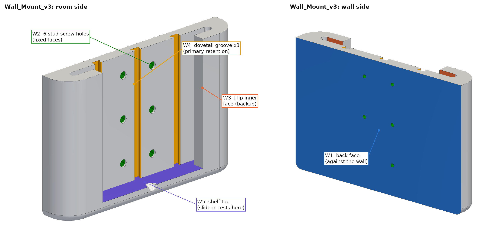
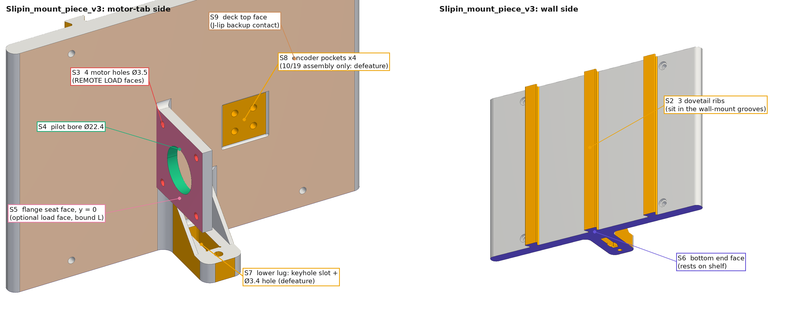
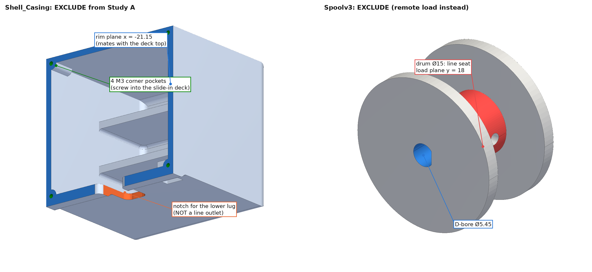
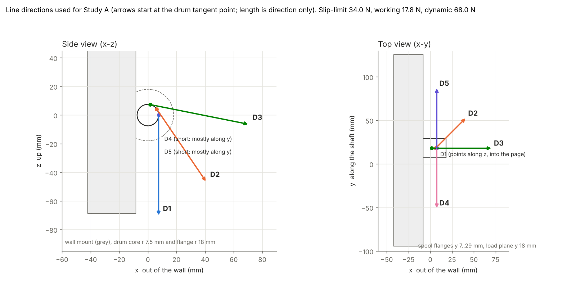

# Study A: linear static stress of the winch-station wall mount and housing

SolidWorks Simulation manual for Jasper. Focused successor to Study 1 of
[`docs/SIMULATION_GUIDE.md`](../SIMULATION_GUIDE.md) (that guide stays valid for the
one-time setup and the generic workflow). Every load, direction, allowable and limit here is derived
in [`calculations/simulation_loads.py`](../../calculations/simulation_loads.py) and traced to
`verification/design_review_gen2.md` (R3, R6, R10), `DECISIONS.md` (D15, D26, D29, **D30**) and the STEP
files. The companion thermal manual is [`SW_THERMAL_HEAT_FIN.md`](SW_THERMAL_HEAT_FIN.md).

**Question this study answers:** with the stepper pulling as hard as it can (slip limit, 34 N at the
D30 current), in any direction the room allows, does the wall mount plus slide-in housing stay under the
derated PETG allowable and keep the cable exit still to within 0.5 mm?

**Time:** about 1 hour once the one-time setup is done (3 required load directions + 2 mesh-refinement runs).
Optional extras are marked *optional*.

---

## 0. The answer sheet (read this first, fill it in at the end)

| Check | Limit | Where it comes from |
|---|---|---|
| P1 Peak von Mises (away from singularities), slip-limit load **34.0 N** | **≤ 8.33 MPa** (factor of safety ≥ 3 on 25 MPa derated yield) | guide: SF ≥ 3 |
| P2 Same model at the dynamic load **68.0 N** | ≤ 16.7 MPa (SF ≥ 1.5). **Identical to P1**: the model is linear, so one check covers both | guide: SF ≥ 1.5 at ×2 |
| P3 First principal stress in layer-sensitive spots, 34.0 N | ≤ 7.5 MPa (22.5 MPa across layers ÷ 3) | review R5: 50 % of 45 MPa |
| P4 Displacement at the cable exit, 34.0 N | **≤ 0.50 mm** (equals ≤ 0.26 mm at the 17.85 N working load) | proposed, section 2.6 |
| P5 Equilibrium: sum of fixture reactions = applied load | within 1 % | model sanity |
| P6 Mesh convergence at the named critical spot | change < 10 % between the two finest meshes | guide step 8 |
| P7 Wall-screw reaction per screw | below one third of the screw's rated withdrawal and shear (hand estimate ≈ 11 N tension, 6.5 N shear) | review R3 |

**Verdict rule.** PASS when P1 to P6 hold for D1, D2, D3 and D4. PASS WITH CONDITION when only the
two bounding along-the-wall cases (D4/D5) fail on the pessimistic *hole-only* load path but pass on the
*flange-seat* bound or on the reachable case D4f (section 2.2). FAIL otherwise; the design actions are in section 10.

**What the numbers will probably look like** (hand estimate of the 5 mm motor tab root, rigid motor, hole-only
load path; the FEA must land within about a factor of 2 of these, otherwise suspect a setup error):

| Case | Tab-root nominal stress | With root-corner concentration (×1.5 to ×2.5) | Cable-exit deflection |
|---|---|---|---|
| D1 down | 3.2 MPa (torsion of the tab) | 4.9 to 8.1 MPa | below 0.05 mm |
| D2 floor-centre diagonal | 3.2 MPa | 4.7 to 7.9 MPa | ≈ 0.27 mm |
| D3 scan, straight out | 3.4 MPa | 5.1 to 8.5 MPa | ≈ 0.17 mm |
| D4 / D5 along the wall (bound) | 5.6 MPa | **8.4 to 14.1 MPa** | ≈ 0.33 mm |
| D4f along the wall, reachable | 4.9 MPa | 7.4 to 12.3 MPa | ≈ 0.22 mm |

So the motor tab, not the wall screws and not the rails, is expected to govern, and the sharp back-side
root corner may read above 8.33 MPa. Strength of the slide-in retention is not an issue (dovetail
bearing about 0.07 MPa, section 9).

---

## 1. Before you start

### 1.1 Files (all in the repo)

| File | Use |
|---|---|
| `solidworks/v3_assembly_2026-10-19/Assem_laundry_v3.STEP` | **Open this one.** Newest geometry (10/19), all parts already positioned |
| `solidworks/v3_2026-10-18/Wall_Mount_v3.STEP`, `Slipin_mount_piece_v3.STEP`, `Shell_Casing.STEP`, `Spoolv3.STEP` | The 10/18 part files. Same geometry to within 0.03 mm, except: the assembly slide-in has four extra encoder pockets (S8), and the assembly still carries the older 19 mm spool (`Spool1011`), not the 22 mm `Spoolv3` |
| `calculations/simulation_loads.py` | Every number below, with sources. Re-run it if an input changes |

### 1.2 One-time setup (from the guide, summarised)

1. Tools → Add-Ins → tick **SOLIDWORKS Simulation** (both columns).
2. Units: document MMGS; Simulation → Options → Default Options → Units → SI, length mm, stress N/mm² (MPa).
3. Create the custom material **PETG FDM (derated)** once (Edit Material → Custom Materials):

| Property | Value | Note |
|---|---|---|
| Elastic modulus | 1800 MPa | printed |
| Poisson's ratio | 0.38 | |
| Mass density | 1270 kg/m³ | |
| Tensile strength | 45 MPa | bulk |
| **Yield strength** | **25 MPa** | derated for layer adhesion; the factor-of-safety plot uses this |

### 1.3 Know the geometry you are loading





Coordinates below are in the **station frame**: origin on the motor shaft axis at the motor flange face,
**+x out of the wall into the room, +y along the shaft toward the spool (horizontal, parallel to the wall),
+z up**. It is the assembly frame shifted by (1269.084, 738.762, 927.557) mm, so force components are the same
in both and only locations differ (appendix, section 12). "Up" is the global +Z axis of the STEP files.

**Wall_Mount_v3** (33.9 × 220 × 145 mm; x −42.32 to −8.45, y −94.44 to 125.56, z −68.60 to 76.40):

| Tag | Feature | Measured |
|---|---|---|
| W1 | Back face (against the wall) | plane x = −42.32, 220 × 145 mm, 31,802 mm² |
| W2 | **6 counterbored stud-screw holes** | Ø3.97 through (x −42.32 to −31.79), Ø7.94 counterbore 2.0 deep (x −31.79 to −29.79). Columns y = −2.78 and 34.22 (37.0 apart); rows z = −34.75, 10.25, 55.25 (45.0 apart) |
| W3 | Two **J-hook lips** at the two ends | slot 8.8 wide, 25 deep along y, R4.1 closed end, open at the top; lip 12.55 thick; **inner lip faces** x = −20.97, 2 × 2,755 mm² |
| W4 | Three **dovetail grooves** (rails) | at y = −34.40, 15.56, 65.60; floor x = −34.79, 5.0 deep, about 9 wide at the floor, undercut; run the full height |
| W5 | **Shelf** the housing rests on | top face z = −55.90, 3,213 mm², shelf 12.7 thick |

**Slipin_mount_piece_v3** (55.8 × 177.8 × 127 mm; x −34.62 to 21.15, y −73.34 to 104.46, z −55.02 to 71.98):

| Tag | Feature | Measured |
|---|---|---|
| S1 | Deck (plate) | 13.47 thick (x −34.62 to −21.15), 177.8 × 127 mm |
| S2 | Three **dovetail ribs** under the deck | at y = −34.44, 15.56, 65.56; 9.1 wide at the tip, 5.0 tall, 127 long |
| S3 | **Motor tab, 4 screw holes** | tab y = 0.0 to 5.0 (5.0 thick), standing on the deck from x = −21.15 to +21.15, z = ±21.15 (42.3 × 42.3); R2.5 root fillet on the spool side only (the back-side root is a sharp corner); **4 × Ø3.5 at (x, z) = (±15.5, ±15.5)** |
| S4 | Pilot bore | Ø22.4 at (0, 0) |
| S5 | Flange seat face | tab back face y = 0.0, 1,358 mm² net of the holes |
| S6 | Bottom end face (rests on the shelf) | z = −55.02, 2,208 mm² |
| S7 | Lower lug | 20 wide, 10 thick, x −19.15 to 13.85, z −55.02 to −45.02, with gussets; keyhole slot 6.6 × 19.3 × 9 deep and a Ø3.4 × 7 deep hole at x = 7.86 |
| S8 | Encoder pockets (10/19 assembly only) | 4 × Ø3.45 × 4 deep at (y, z) = (40.25 / 49.75, ±4.75) in a shallow recess |
| S9 | Deck top face | x = −21.15, 19,841 mm² |
| S10 | Shell screw holes | 4 × Ø3.5 at (y, z) = (−43.09 / 74.21, −46.52 / 63.48), Ø6.5 × 2 counterbore from the wall side |



### 1.4 What the STEP files do and do not contain (assumptions that shape the model)

1. **There is no pulley, outlet ring or line opening in the v3 files.** The shell's arched notch is the
   pass-through for the lower lug S7 (20.5 mm wide for a 20 mm lug), not a line outlet. So the line force is
   applied **at the spool drum** and carried spool → shaft → motor → 4 motor screws → motor tab → slide-in
   (S3 holes). If an outlet is later added to the shell or slide-in, the force enters there instead and this
   study must be repeated with the force on the outlet faces. **[ASSUMED, flag it on the slide]**
2. The shell is not on the line-load path in this model, so it and the spool and motor are **excluded**. Their
   weights are applied as forces (section 4.3).
3. **Retention.** Horizontal pull-away is held by the three dovetail ribs and, as backup after about 0.18 mm of
   slip, by the J-lips. **No retention screw or pin exists in these files**: the lug's Ø3.4 hole has no counterpart
   on the wall mount (the wall mount ends at x = −8.45, the hole is at x = +7.86). Nothing holds the slide-in
   *up*, which is acceptable only because a ceiling-corner line always pulls downward (the unit vector never has a +z
   component).
4. In the assembly the slide-in floats **0.88 mm above the shelf**, 0.18 mm off the lips, and the centre rib's
   dovetail flank overlaps the wall mount by about 0.02 mm (36.7 mm³ in total). Section 3.6 deals with these.
5. The 0.483 mm heat fin is not in the assembly; the motor flange sits directly on the tab. The real stack is
   0.48 mm thicker, which is immaterial here.
6. Print orientation is not recorded **[ASSUMED]**: wall mount back-face down, slide-in deck-side down, so
   layers run parallel to the wall and the motor tab root is loaded **across layers** (the weak direction).

---

## 2. Loads and boundary values (all from the loads calculation)

### 2.1 Cable tension

| Quantity | Arithmetic | Value |
|---|---|---|
| Driver current | Vref 0.85 V ÷ (8 × 0.100 Ω) (D30) | 1.0625 A |
| Holding torque | 0.36 N·m × 1.0625 / 1.5 A | 0.2550 N·m |
| **Slip-limit tension** (empty spool, r = 7.5 mm) | 0.2550 / 0.0075 | **34.0 N** (checks: 32.0 N at 1.0 A, 48.0 N at 1.5 A) |
| **Working tension**, largest the winch can pull while moving (full spool, r = 10 mm) | 0.7 × 0.2550 / 0.010 | **17.85 N** |
| **Dynamic (abuse bound)** | 2 × 34.0 | **68.0 N** |
| For reference: running pull at the empty core (not a tension the claw demands: the claw is low and the line paid out) | 0.7 × 0.2550 / 0.0075 | 23.8 N |
| For reference: design force with the 1.5 skip margin, full spool | 17.85 / 1.5 | 11.9 N |

**Status note (10/21 erratum to D29/D30, `DECISIONS.md`, and `docs/decisions/WINCH_CAPACITY_20261021.md`).** The 34 N is the
*holding* (snag / slip) force that the structure must survive, not the running pull the planning uses (23.8 N at the core, 17.9 N at a full spool,
11.9 N design force); the table above agrees with that erratum. Two consequences: (1) the luggage-scale pull test the memo recommends replaces the assumed
0.7 running-torque factor with a measured value, and a different measured slip or running pull simply rescales this study (section 7.1); (2) if the 3:1 winch reduction
(option 1 of the memo, to be recorded as D31) is adopted, the slip limit at the line rises by about 2.7 times (to roughly 92 N at 1.06 A) and the line enters through a gear
housing, so this study must be repeated on the new station; on the current geometry the safety factors would fall by the same 2.7.

**Which motor figure.** The repo uses one number everywhere, the SIMAX3D 42-38 at **36 N·cm at 1.5 A**
(shopping list, review R10, all `calculations/gen2_*.py`), and that is what produces the authoritative 32 N / 48 N.
The brief names the 17HS4401 at about 40 N·cm; the repo has no datasheet for it. We use 36 N·cm so the loads match
the recorded ones, and carry 40 N·cm as a sensitivity: **every load and every result scales by ×1.111**
(slip limit 37.8 N), i.e. divide every factor of safety by 1.111. If your installed motors are the 40 N·cm part,
require SF ≥ 3.33 in the 36 N·cm tables below.

### 2.2 Line directions (unit vector points from the station toward the claw)



Polar angle θ is measured from straight down, azimuth ψ from +x toward +y. The 43.9° and 78.7° cone angles are
the recorded figures (T18, the old 4 × 3 × 2.6 m room). For the real 11 × 9 × 9 ft room the same cases read 38.9°
(floor centre), 79.2° (room centre at the 0.4 m ceiling margin) and up to 84.3° (far corner at the ceiling margin), so
78.7° is representative of the high-scan worst case, not an upper bound.

| Case | Meaning | θ, ψ | Unit vector (x, y, z) | Required? |
|---|---|---|---|---|
| **D1** | straight down | 0°, 0° | (0, 0, −1) | yes |
| D2 | floor-centre diagonal | 43.9°, 45° | (0.4903, 0.4903, −0.7206) | recommended |
| **D3** | scan, straight out from the wall | 78.7°, 0° | (0.9806, 0, −0.1959) | yes |
| **D4** | scan, along the wall toward −y (motor side). *Bound.* | 78.7°, −90° | (0, −0.9806, −0.1959) | yes |
| D5 | same toward +y. *Bound.* | 78.7°, +90° | (0, +0.9806, −0.1959) | optional |
| D4f | along the wall, **reachable** (fleet limited to 26.1°, the most the line can swing across the 16 mm drum before scrubbing an 18 mm flange) | | (0.8810, −0.4392, −0.1760) | only if D4 fails |

### 2.3 Force components and load points (station frame)

The line leaves the drum tangentially on the room (+x) side, so the **load point** is the tangent point on the
r = 7.5 mm core at the drum mid-plane **y = 18.0 mm** (the 22 mm spool spans y = 7 to 29; if yours sits differently,
change Y). Forces are what the line does to the station.

| Case | Load point X, Y, Z (mm) | F at **34.0 N** (Fx, Fy, Fz) N | F at 17.85 N | F at 68.0 N |
|---|---|---|---|---|
| D1 | 7.50, 18.00, 0.00 | 0, 0, −34.00 | 0, 0, −17.85 | 0, 0, −68.00 |
| D2 | 6.20, 18.00, 4.22 | +16.67, +16.67, −24.50 | +8.75, +8.75, −12.86 | +33.34, +33.34, −49.00 |
| D3 | 1.47, 18.00, 7.35 | +33.34, 0, −6.66 | +17.50, 0, −3.50 | +66.68, 0, −13.32 |
| D4 | 7.50, 18.00, 0.00 | 0, −33.34, −6.66 | 0, −17.50, −3.50 | 0, −66.68, −13.32 |
| D5 | 7.50, 18.00, 0.00 | 0, +33.34, −6.66 | 0, +17.50, −3.50 | 0, +66.68, −13.32 |
| D4f | 1.47, 18.00, 7.35 | +29.95, −14.93, −5.99 | +15.72, −7.84, −3.14 | +59.91, −29.87, −11.97 |

**You only run the 34.0 N column.** The model is linear, so working and dynamic results are the same fields
multiplied by 17.85 / 34.0 = 0.525 and 68.0 / 34.0 = 2.0 (section 7).

### 2.4 Weights (applied as forces, section 4.3)

| Item | Mass | Force (−z) | Location X, Y, Z (mm) | Source |
|---|---|---|---|---|
| Motor + spool + line | 0.29 kg | 2.845 N | 0, −19, 0 | 0.28 kg motor from the guide + 10 g spool |
| Shell + electronics | 0.25 kg | 2.453 N | 39, 15.6, 8 | **[ASSUMED]** weigh it; a solid shell would be 0.47 kg |

Scaling the combined result by 0.525 or 2.0 overstates the weights slightly at 68 N and understates them at
17.85 N; both effects are below 7 % of the stress.

### 2.5 Allowables and targets

| Quantity | Value | Source |
|---|---|---|
| Derated yield | 25 MPa | guide |
| Allowable von Mises at 34.0 N (SF 3) | 8.33 MPa | 25 ÷ 3 |
| Allowable von Mises at 68.0 N (SF 1.5) | 16.7 MPa | 25 ÷ 1.5; same criterion as above |
| Allowable first principal across layers (SF 3) | 7.5 MPa | 0.5 × 45 = 22.5 (R5) ÷ 3 |
| Hot-tab sensitivity (motor-warmed PETG, about 55 °C) | 5.8 MPa | **[ASSUMED]** strength ×0.7; check the thermal manual's motor temperature |

### 2.6 Deflection limit at the cable exit: ≤ 0.5 mm at 34.0 N

Anchor motion turns into claw position error about 1:1 (calibration sensitivity study). 0.5 mm at 34.0 N means a station
stiffness of at least 68 N/mm, which is 23 times the estimated Dyneema line stiffness (about 3 N/mm over a 3 m run, review R1), so
the station adds less than 5 % to the compliance in series with the line (the line alone stretches about 6 mm at the
working load, which calibration absorbs). It is also 2.5 % of the roughly 20 mm absolute-length uncertainty that vision
calibration leaves (D24, D26), and it is the existing guide's criterion. At the 17.85 N working load it is 0.26 mm.
**The study is elastic only.** The drawn fit clearances (0.15 mm per side, 0.3 mm total in x and in y) are
*play*, not deflection; add them to the exit-position budget separately (total budget proposed: elastic + play ≤ 1.0 mm).

---

## 3. Build the model (about 25 minutes)

### 3.1 Open and save

1. File → Open → type **STEP AP203/214** → `Assem_laundry_v3.STEP` → Options → import as an **assembly**
   (not a single part). Five components appear: `Wall_Mount_v3`, `Slipin_mount_piecev3`, `Shell_Casing`, `Spool1011`, `Motor_Reference`.
2. Save as `Station_StudyA.SLDASM` in a scratch folder. Do not save back into `solidworks/`.
3. Orient the view so the global **+Z axis points up** on screen (the triad shows Z; use View Orientation or
   Shift + arrow keys to rotate 90° at a time). All the pictures use this orientation.

### 3.2 Create the STATION coordinate system

1. Insert → Reference Geometry → **Point** → type *Arc center* → select the circular edge of the Ø22.4 pilot hole on the motor
   tab's **back** face (y = 0, S4/S5). The point lands at (0, 0, 0) in the station frame.
2. Insert → Reference Geometry → **Coordinate System** → Origin: that point. Leave the axes at their defaults (they follow
   the global axes). Name it `STATION`. (Check with Tools → Evaluate → Measure: the point reads X ≈ 1269.08, Y ≈ 738.76, Z ≈ 927.56 mm in the global frame.)

### 3.3 Defeature (delete faces that add elements but no stress information)

Insert → Face → **Delete** (the Delete Face feature, option *Delete and Patch* or *Delete and Fill*) for:

| What | Faces |
|---|---|
| S8 encoder recess and its 4 pockets | the recess floor, walls and the 4 Ø3.45 pockets (15 faces) |
| S7 lower-lug keyhole slot and Ø3.4 / Ø4.1 hole | 36 small faces, in the picture marked yellow S7 |
| Wall mount nose groove in the shelf (centre, y = 15.56) | the 2 mm slot with its two bevels, 11 faces, optional |

Keep everything else. Do **not** delete the holes S3/S4, the R2.5 root fillets at the tab, or W2.

### 3.4 Study setup (the study must exist before the next two steps)

1. Simulation tab → **New Study** → name `A_D1_slip` → type **Static** → OK.
2. Right-click the study → **Properties** → Options: Solver *Automatic*, leave *Large displacement* off. (Tick *Use soft spring* only for Option B.)
3. Right-click *Parts* → **Apply Material to All** → *PETG FDM (derated)*.

### 3.5 Exclude the parts that carry no line force

In the Simulation tree under *Parts* right-click **Shell_Casing**, **Spool1011** and **Motor_Reference** →
**Exclude from Analysis**. Only the wall mount and the slide-in are meshed.

### 3.6 Connections: how the slide-in and the wall mount meet

**Decision: Bonded, with the clearances ignored.** Reasons: (1) the load keeps the carrying faces pressed together
(dovetail flanks, shelf, lips), so bonded gives the same load path as no-penetration for these loads; (2) the
as-modelled clearances are 0.13 to 0.21 mm everywhere except one dovetail flank that overlaps by 0.02 mm, which makes
no-penetration contact start with gaps and an overlap and converge badly; (3) bonded keeps the study linear, so scaling
to the other tension levels is exact. The cost: bonded also glues faces that would open in reality, so **do not quote
stresses on the dovetail flanks or J-lip faces from this model** (use the hand check in section 9).

Option A (try first): Simulation tree → right-click **Connections** → **Component Contact** → type **Bonded** →
under *Options/Advanced* tick **Ignore clearance for surface contact** and enter **0.25 mm** (larger than every drawn clearance,
smaller than the 0.88 mm shelf gap, so the shelf stays free). The slide-in is then glued over the dovetail ribs, the
underside and the lips and rests on the shelf by the load pressing it down.

Option B (if the tick box does not exist in your release or the slide-in "flies" away): type **No Penetration**, then in the
study properties tick **Use soft spring to stabilize model**, and add one mate to seat the housing:
Coincident between the slide-in bottom end face S6 and the wall-mount shelf top W5. Afterwards check
Results → List Resultant Force on the soft springs: it must be below 1 N.

---

## 4. Fixtures, loads and mesh (about 15 minutes)

### 4.1 Fixture F1: wall screws

Simulation tab → Fixtures Advisor → **Fixed Geometry**. Select, for each of the six W2 holes: the **bore** (two half-cylinders; right-click one →
*Select Tangency* to get both) and the **counterbore shoulder** (the flat ring facing the room, x = −31.79). That is 18 faces
(green in the wall-mount picture). Name it `F1_screws`.

**Why fixed hole faces and not bolt connectors.** A screw is far stiffer than PETG, the preload is unknown, and bolt connectors need washer
and nut faces that are not modelled. Fixed bore and shoulder faces constrain pull-out and shear exactly as a rigid screw would and let you read the load on
each screw (section 5). Their one weakness is that they hold the plate where the real wall would only press, so run the optional
*wall-present* variant: add **Roller/Slider** on the back face W1 and compare the tab values (they should agree; if the top-screw tension
rises a lot, prying matters).

### 4.2 Load L1: the cable pull (Remote Load)

External Loads Advisor → **Remote Load/Mass**:

| Field | Entry |
|---|---|
| Type | **Load (Direct Transfer)** |
| Faces for Load | the **4 motor-screw holes S3** (8 half-cylinders; red in the slide-in picture) |
| Reference coordinate system | `STATION` |
| Location | X, Y, Z from section 2.3, case D1: 7.50, 18.00, 0.00 (mm) |
| Force | translational components along X, Y, Z: 0, 0, −34.00 N for D1 |
| Moment | none (SolidWorks adds the moment of the offset automatically) |

Check the preview arrow: for D1 it must point **down**, from the drum point. Name it `L1_cable`.

*Why the 4 holes.* The motor is bolted to the tab by exactly these four screws, so this is where the pull enters the
housing. It is the **pessimistic bound U**: it ignores the motor flange resting against the tab, which in reality spreads the load over the
flange seat S5. Optional bound L (run it on the governing case only): select the **tab back face S5** instead of the holes. Report both; the truth lies between.

### 4.3 Loads L2 and L3: weights

1. Gravity: Advisor → **Gravity** → Reference Plane: the global XY plane, **Reverse direction** until the arrow points toward −Z. Name `L0_gravity`.
2. Remote Load (Direct Transfer), `L2_motor_weight`: faces = the same 4 S3 holes; Location 0, −19, 0; Force 0, 0, −2.845 N.
3. Remote Load (Direct Transfer), `L3_shell_weight`: faces = the 4 S10 holes (8 half-cylinders in the deck); Location 39, 15.6, 8; Force 0, 0, −2.453 N.

### 4.4 Check the starting geometry (2 minutes)

Tools → Evaluate → Interference Detection on the two components: expect the one tiny overlap (≈ 37 mm³ on the centre dovetail). If
it is much larger you moved a component; reopen the STEP.

### 4.5 Mesh

Right-click **Mesh** → Create Mesh → **Curvature-based mesh**, *High* quality (quadratic tets), Jacobian points 4. Then right-click Mesh →
**Apply Control** on the critical faces (select by clicking; sizes are global ÷ 3):

| Control | Faces |
|---|---|
| C1 | the motor tab entire front and back faces, the 4 S3 holes, the S4 pilot bore, **the R2.5 root fillets** where the tab meets the deck |
| C2 | the centre dovetail rib and groove (faces of S2 centre rib) |
| C3 | the W2 hole group at the lowest row (to catch screw bearing) |

Three mesh levels for the convergence check (≥ 3 levels, section 6). Element counts are estimates from the 820 cm³ of retained material:

| Level | Global size | Min size | Control size C1 | Elements (est.) |
|---|---|---|---|---|
| M1 coarse | 8 mm | 2.0 mm | 2.7 mm | about 15 k |
| M2 medium | 5 mm | 1.2 mm | 1.7 mm | about 60 k |
| M3 fine | 3.5 mm | 0.8 mm | 1.2 mm | about 170 k (a few minutes, about 4 GB) |

Run M2 first.

### 4.6 Run D1

**Run This Study.** Fix any warning about the Ø4.1 or 0.2 mm features by deleting those faces. Then do the checks of section 5 before building the other cases.

---

## 5. Sanity checks (5 minutes, do not skip)

1. **Equilibrium (P5).** Right-click Results → **List Resultant Force** → select the 18 faces of F1 → Update. The sum must equal the negative of the applied loads plus weights (loads + 5.30 N weights):

| Case | Expected reaction Σ (X, Y, Z) N |
|---|---|
| D1 | 0, 0, +39.30 |
| D2 | −16.67, −16.67, +29.80 |
| D3 | −33.34, 0, +11.96 |
| D4 | 0, +33.34, +11.96 |
| D5 | 0, −33.34, +11.96 |

   Within 1 %. If not, a load direction or reversal checkbox is wrong.
2. **Where is the peak?** Plot von Mises. It should sit on the motor tab root, not at a fixture hole edge and not at the far end of the model. A peak at a W2 hole edge or at the tab holes is a point-load singularity (judge them with section 6).
3. **Magnitude.** Compare with the hand-estimate table in section 0. The tab-root nominal stress of 3 to 5 MPa and the exit deflection of 0.2 to 0.3 mm must be within a factor of 2.
4. **Screw loads (P7).** *List Resultant Force* on one screw's faces at a time (or on a column of three). Per-screw tension at the top row should be about 11 N (D1) and shear about 6 N; the hand estimate is a conservative screws-only calculation. Compare with the screw maker's rated withdrawal from a stud; require rated ÷ 3. Into a stud only, never drywall anchors (R3).

---

## 6. Mesh convergence (about 12 minutes)

Pick the **governing case** (the one with the highest peak so far; expect D4, otherwise D3). Change only the mesh, never the load.

1. Duplicate the study (right-click the study tab → **Duplicate**), rename `A_D?_M1`, and re-mesh with M1; again for M3 (`A_D?_M3`). Re-run both (M2 already exists).
2. Record in this table, using the **same probe location** each time: Results → *Probe* → on the tab root front fillet face (R2.5, x −21.15 to −18.65, y 5.0 to 7.5): the **maximum** of von Mises there; and on the tab-hole faces for displacement.

| Mesh | Elements | Peak vM at tab-root fillet (MPa) | Δ vs previous | Max URES on S3 holes (mm) | Δ vs previous |
|---|---|---|---|---|---|
| M1 | | | , | | , |
| M2 | | | | | |
| M3 | | | | | |

3. **Pass (P6):** the M2 → M3 change is below 10 % at the fillet probe. The global maximum may keep climbing at: (a) the **sharp
   back-side root corner** of the tab (y = 0, x = −21.15, no fillet in the model), (b) the edges of the four S3 holes (point
   loads), (c) the W2 hole edges (point fixtures). Those are singularities. For (a) quote the stress **1 mm away from the corner**
   (probe a node 1 mm out) and treat the corner itself as a **design finding**: add a 2 mm fillet to the back-side root in the CAD, re-run, and the peak converges.

---

## 7. The other directions (about 10 minutes)

Right-click the converged study tab → **Duplicate** for each case, keep the mesh, and edit **only** `L1_cable` (location, then three force components) from the 34.0 N column of section 2.3. Rename `A_D3_slip`, `A_D4_slip`, and optionally `A_D2_slip`, `A_D5_slip`. **Run, check section 5.1 reaction, and record.** For D4/D5 (along the wall), the tab sees mostly out-of-plane force. If you chose Option B, re-check the soft-spring reaction.

*Optional bounds on the governing case only:* (i) flange-seat load faces S5 (bound L); (ii) wall-present Roller/Slider on W1; (iii) D4f if D4 fails.

### 7.1 Scale to the other tension levels (no more runs)

For any recorded stress σ34 and displacement δ34 at 34.0 N:

| Level | Multiply by | SF = 25 / σ |
|---|---|---|
| Working 17.85 N | 0.525 | SF₁₇ = SF₃₄ ÷ 0.525 = 1.90 × SF₃₄ |
| Dynamic 68.0 N | 2.00 | SF₆₈ = SF₃₄ ÷ 2 |
| 40 N·cm motor sensitivity (37.8 N) | 1.111 | SF₄₀ = SF₃₄ ÷ 1.111 |

---

## 8. Results to plot and save for the slides

Save every plot as an image (right-click the plot → Save As, or Simulation → Result Tools). Use the governing case plus D1. Turn the min/max
annotation on and the mesh display off.

| File name | Plot and settings |
|---|---|
| `A_vm_<case>.png` | **Stress1 von Mises**, units MPa. Edit Definition → Chart Options → *Defined* maximum **8.33 MPa** (the allowable), minimum 0, so anything red is over the limit. Deformation scale: *true scale*, or 1:1 if "auto" exaggerates; say which on the slide |
| `A_p1_<case>.png` | **First principal** (Stress2, 1st principal), layer-sensitive spots: tab root, dovetail rib roots, J-lip roots. Chart maximum **7.5 MPa**. Zoom on the tab |
| `A_ures_<case>.png` | **Displacement URES**, mm, true scale, annotation on the S3 hole faces; also report the cable-exit value |
| `A_fos_<case>.png` | Results → **Define Factor of Safety Plot** → criterion *Max von Mises stress* → limit *Yield strength* (25 MPa) → *Factor of safety distribution* and tick **Areas below factor of safety: 3** (those show red) |
| `A_first_principal_across_layers.png` | optional: same FoS tool with criterion *Max normal stress* and a **user-defined limit 22.5 MPa**, *areas below 3* |

For the 68.0 N slide the same FoS plot is valid with the threshold set to 1.5 (it is identical in meaning: SF 3 at 34 N is SF 1.5 at 68 N).

---

## 9. Retention (review R3) by hand and what the FEA adds

Pull-away force at D3 is 33.3 N (and 66.7 N dynamic). Dovetail flank bearing, three ribs sharing it over one inclined flank
each (assumed 25° flank angle): **0.065 MPa**. J-lip bearing if only a quarter of the lip area is pressed: 0.024 MPa. Both are a factor of about 100 below the 8.33 MPa
allowable, so the question is not strength but **fit, creep and print variation** (clearance 0.15 mm per side). The FEA shows the load path through the rest of the
housing; it cannot show retention quality because the contact is bonded. Retention in the loaded direction is geometric (positive,
independent of friction) as R3 requires; **in the slide-out (up) direction there is no retention at all**, only gravity. Tell the reviewer that plainly, and
say that the ceiling-corner geometry means the line never has an upward component.

---

## 10. Pass/fail table and what to do if it fails

Fill the status column from your numbers (section 11 template).

| Check | Limit | Result | Status |
|---|---|---|---|
| P1 peak vM (non-singular), D1 | ≤ 8.33 MPa | | |
| P1 D2 | ≤ 8.33 MPa | | |
| P1 D3 | ≤ 8.33 MPa | | |
| P1 D4 (bound U) | ≤ 8.33 MPa | | |
| P1 D4 with bound L or D4f | ≤ 8.33 MPa | | |
| P3 first principal at tab root | ≤ 7.5 MPa | | |
| P4 exit deflection (worst case) | ≤ 0.50 mm | | |
| P5 reactions | ± 1 % | | |
| P6 convergence | < 10 % | | |
| P7 screw reaction | ≤ rated ÷ 3 | | |

**If P1 fails at the tab root** (most likely at the sharp back-side corner or in D4): (1) add a 2 mm fillet on the back-side root and re-run; (2) add a triangular gusset on the
spool side of the tab (the lug already has one); (3) print the tab with the layers perpendicular to the tab root, or in ASA/ABS if the motor temperature (thermal manual) makes the PETG soft; (4) reduce the driver current (34 N scales with current).
**If P4 fails**, the cure is a stiffer tab (thicker than 5 mm, or ribs), not a bigger mesh.

---

## 11. Results-recording template (paste into `verification/simulation_results_station_mount.md`)

```
Study A, station wall mount + housing. Run by: ____  Date: ____  SolidWorks release: ____
Geometry: Assem_laundry_v3.STEP (10/19)   Material: PETG FDM (derated) E 1800 MPa, yield 25 MPa
Motor basis: 36 N.cm @1.5 A, I = 1.0625 A, slip-limit 34.0 N, working 17.85 N, dynamic 68.0 N
Connection: Option A / B (circle)   Load path bound: U (holes) / L (flange seat)   Wall roller: off / on
Mesh used for the table: M__ (global __ mm, __ elements)

| Case | Peak vM (MPa) | Location | Peak 1st principal at root (MPa) | Min FoS (plot) | Exit URES (mm) | Reaction check | SF at 17.85 N | SF at 68 N | Pass? |
| D1 | | | | | | | | | |
| D2 | | | | | | | | | |
| D3 | | | | | | | | | |
| D4 | | | | | | | | | |
| D4f / bound L (if needed) | | | | | | | | | |

Convergence (governing case ___): M1 ___ / M2 ___ / M3 ___ MPa at the R2.5 root fillet probe; change M2->M3 ___ %.
Per-screw reaction: top row ___ N tension, ___ N shear (limit rated/3 = ___ N).
Soft-spring reaction (Option B only): ___ N.
Findings to carry into the design: ___
Plots saved: A_vm_*, A_p1_*, A_ures_*, A_fos_*.
```

---

## 12. Appendix

### 12.1 Locations in the assembly (global) frame, if you did not make the STATION system

Add (1269.084, 738.762, 927.557) mm to a station location:

| Item | Station X, Y, Z | Global X, Y, Z |
|---|---|---|
| D1, D4, D5 load point | 7.50, 18.00, 0.00 | 1276.58, 756.76, 927.56 |
| D2 load point | 6.20, 18.00, 4.22 | 1275.28, 756.76, 931.78 |
| D3, D4f load point | 1.47, 18.00, 7.35 | 1270.55, 756.76, 934.91 |
| Motor weight location | 0, −19, 0 | 1269.08, 719.76, 927.56 |
| Shell weight location | 39, 15.6, 8 | 1308.08, 754.36, 935.56 |

### 12.2 Assumptions to replace by measurements

| Assumption | Replace with | Effect |
|---|---|---|
| Line force enters at the drum, no outlet in the model | the real outlet geometry when designed | changes the load path and the moment arm |
| Drum mid-plane y = 18.0 mm | measure the installed spool | moves the lever on the tab by the offset |
| Shell + electronics 0.25 kg | weigh the printed shell and electronics | ± 2.5 N on the housing |
| PETG print orientation (layers parallel to the wall) | the real print orientation | decides which stress limit applies at the tab root |
| 36 N·cm motor | the installed motors' measured pull-out | scales every load (×1.111 for 40 N·cm) |
| E = 1800 MPa isotropic and solid | printed infill and perimeters | real stiffness is typically lower; a pull test checks it |

---

## 13. What this study cannot tell you, and the physical pull test that closes the gap

- **Creep.** Hanging load on PETG relaxes the tab over days. The working tension of 17.85 N gives about
  4.4 MPa at the allowable, roughly 10 % of the 45 MPa bulk strength, which is the usual starting point for sustained thermoplastic load, but
  nothing here proves it. The motor warms the tab (see the thermal manual); hot PETG creeps faster.
- **Layer anisotropy and print defects.** The solver is isotropic and solid. Real tabs have layer lines (the root is loaded across them), seams, voids,
  under-extrusion at thin walls and 0.15 mm fit tolerances that vary part to part.
- **Infill.** 100 % solid is assumed. Real parts at 20 to 40 % infill are softer; deflection will be larger than the FEA.
- **Joints.** Screw preload, wood-stud strength and drywall flex are not modelled; the contact between slide-in and wall mount is bonded.
- **Dynamics.** The ×2 factor stands in for jerk and snags; it is not a transient analysis. Resonance of the cantilevered motor is not covered.
- **The line outlet** (section 1.4).

### 13.1 Pull test (about 90 minutes, two people)

1. Screw a printed wall mount to a stud or a 2 × 4 with the **same six screws** as the install. Insert a printed slide-in with the real motor (no
   spool needed: a short line tied to the Ø1.4 hole or a loop around the drum).
2. Hang the load through the line over the drum at the three angles D1 (0°), D3 (78.7° from vertical, i.e. 11.3° below horizontal) and D4 (along the wall). Use dead weights or a spring
   scale with a pulley or protractor. Load in steps: 0, 17.85, 34, 51, 68 N, holding each for 2 minutes.
3. Measure displacement of the motor flange face with a dial indicator (0.01 mm) on a magnetic base fixed to the stud. Record the **second** cycle (the first
   seats the dovetails and takes up the 0.3 mm play). Also record any creak, crack or visible whitening at the tab root.
4. Hold 17.85 N for 1 hour and record the creep (extra displacement). Repeat once with the motor held at about 50 °C after a hold test.
5. **Pass limits.** At 34 N the elastic displacement ≤ 0.50 mm and no cracks; at 68 N for 60 s no cracks and a permanent set after unloading ≤ 0.10 mm;
   creep at 17.85 N for 1 h ≤ 0.10 mm. If the measured stiffness is within about ±30 % of the FEA the model is validated; a softer part usually means
   infill or print orientation, and the FEA stresses should then be raised in proportion. Test three printed samples; one outlier is a print defect, two means the design.
6. **Optional proof to failure** on one spare tab: load until yield or crack, compare the failure load with the 3 × 34 N ≈ 100 N the derated yield predicts at SF = 1.

---

## 14. Troubleshooting

| Symptom | Cause and cure |
|---|---|
| "Rigid body motion" or huge displacement | Component contact did not bond across the 0.15 mm gaps: tick *Ignore clearance* (0.25 mm) or use Option B with soft springs |
| Peak at a hole edge | point-load singularity; probe the root fillet instead (section 6) |
| Reaction sum is off by the load | a force reversal or wrong coordinate system: check the preview arrow and that `STATION` is selected |
| D4 far higher than D3 | expected: out-of-plane force on a 5 mm tab (section 0); run bound L and D4f |
| Mesh failure on thin ribs | delete the small faces listed in 3.3; use Curvature-based with minimum size 0.8 mm |

*Links:* [guide](../SIMULATION_GUIDE.md) · [design review R3/R6/R10](../../verification/design_review_gen2.md) ·
[loads calculation](../../calculations/simulation_loads.py) · [thermal manual](SW_THERMAL_HEAT_FIN.md).
