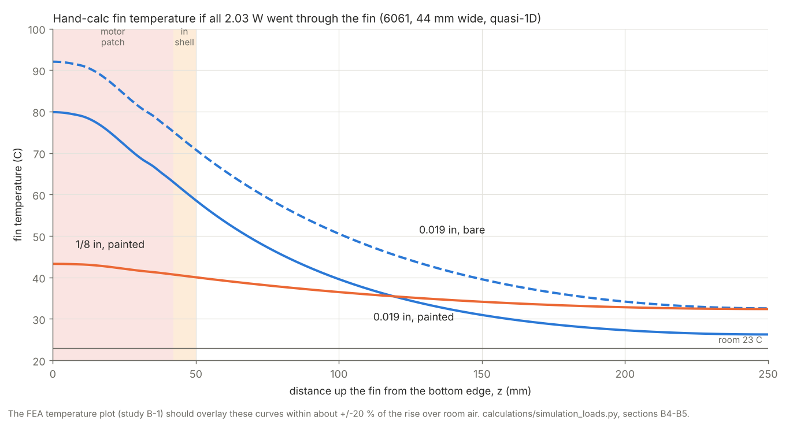
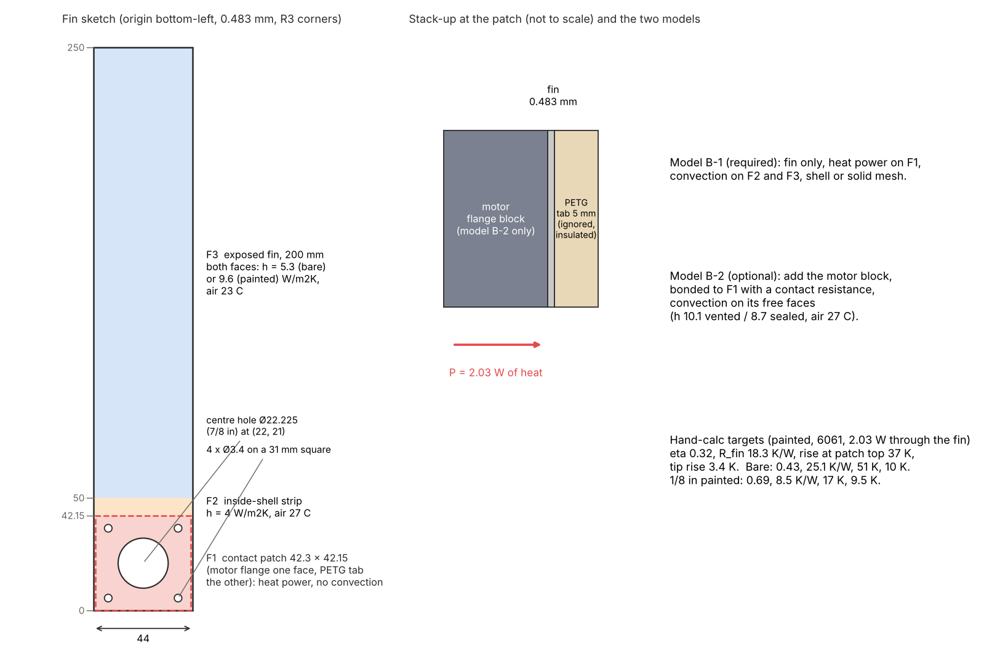

# Study B: steady-state thermal of the aluminium motor heat fin

SolidWorks Simulation manual for Jasper. Companion to [`docs/SIMULATION_GUIDE.md`](../SIMULATION_GUIDE.md) (that guide covers structural studies only; the thermal
reasoning is in review R11 and the DESIGN_STATE heat-fin entries, and this is the first thermal manual). Every input and every target below is derived in
[`calculations/simulation_loads.py`](../../calculations/simulation_loads.py), which also holds the
two-node motor model convention from `calculations/gen2_motor_thermal.py`. The structural companion is
[`SW_STATIC_STATION_MOUNT.md`](SW_STATIC_STATION_MOUNT.md).

**Question this study answers:** how much does the 0.019 in sheet fin lower the winch motor's temperature at the D30 current,
does a finite-element model reproduce the hand calculation, and why would the 1/8 in design have been better?

**Time:** about 1 hour (model 10 min, one run 10 min, alloy and finish sensitivity 15 min, 1/8 in repeat 10 min, table and slides 15 min).

---

## 0. The answer sheet

Hand-calculation targets for the fin as built (6061, 44 mm wide, 200 mm exposed, both faces, all **2.03 W** forced through the fin,
room air 23 °C). The FEA of model B-1 must reproduce the **rise over room air** within about **±20 %**.

| Fin | η = tanh(mL)/mL | R_fin = 1/(hηA) | Rise at the top of the contact patch (z = 42 mm) | Tip rise (z = 250 mm) | Patch-average rise (quasi-1D, includes the hole) |
|---|---|---|---|---|---|
| **0.019 in, black paint** (h 9.6) | **0.32** | **18.3 K/W** | **37.3 K** (band 29.8 to 44.7) | 3.4 K | 50.2 K |
| **0.019 in, bare** (h 5.3) | **0.43** | **25.1 K/W** | **51.0 K** (band 40.8 to 61.2) | 10.2 K | 62.4 K |
| 1/8 in (3.175 mm), black paint | 0.69 | 8.5 K/W | 17.3 K (band 13.9 to 20.8) | 9.6 K | 19.3 K |
| 1/8 in, bare | 0.80 | 13.4 K/W | 27.3 K (band 21.8 to 32.8) | 19.1 K | 28.7 K |

What the fin does to the **motor** (coupled model B-2 inputs, paste contact, 1.0625 A, room 23 °C):

| Case | Vented shell | Sealed shell |
|---|---|---|
| No fin | 50.9 °C (rise 27.9 K) | 63.8 °C (rise 40.8 K) |
| 0.019 in, bare | 43.2 °C | 49.7 °C |
| **0.019 in, black paint** | **41.6 °C (rise 18.6 K), 0.72 W through the fin** | **47.3 °C** |
| 1/8 in, black paint | 35.1 °C (rise 12.1 K), 1.21 W through the fin | 37.7 °C |

Three findings worth a slide: (1) the thin fin carries only about a third of the motor heat (0.72 of 2.03 W) because the motor also sheds
12 K/W directly to the shell air; (2) paint matters a lot for the *fin* (R_fin 18.3 vs 25.1 K/W) but little for the *motor* (18.6 vs 20.2 K rise);
(3) the thick fin would cut the motor's rise from 18.6 K to 12.1 K because a 0.483 mm sheet has η = 0.32 (most of its length does almost nothing) against 0.69 for 3.175 mm.
Alloy uncertainty is minor (section 3.2).

**Cross-check with the presentation sheet.** `docs/presentation/FUNDAMENTALS.md` topic 3 (single h = 7 W/m²K, 1 K/W contact) gives 41 °C vented, 46 °C sealed and 36 °C for the 1/8 in fin;
the B-2 numbers above (41.6, 47.3 and 35.1 °C) agree to within 1.5 K. This manual adds the finish split (paint versus bare), the hole and spreading effect in the fin, and the thermocouple predictions.

Passing means: FEA θ at the top of the patch inside the band above, energy balance closes to 1 %, and the picture of the temperature along the fin matches
`img/thermal_hand_calc.png`. The model is **validated** only after the hold test of section 8 agrees with B-2.

---

## 1. Inputs, with where each one comes from

| Input | Value | Source / status |
|---|---|---|
| Driver current | 1.0625 A | Vref 0.85 V ÷ (8 × 0.100 Ω), D30 (≈ 1.06 A) |
| Coil resistance | 1.8 Ω per phase | repo `R_PHASE` in `gen2_motor_thermal.py`, "measure with a meter" **[ASSUMED]** |
| **Motor heat P** | **I² R = 1.0625² × 1.8 = 2.03 W** | convention checked: the A4988 holds I_a² + I_b² = I_trip² at any microstep position, so holding loss does not depend on the phase; full-step with both coils at 0.707 I_trip gives the same total, and `gen2_motor_thermal.py` uses `p_m = i*i*R_PHASE` |
| Scaling | heat and all rises ∝ I² | at 0.99 A (the earlier 0.79 V measurement) P = 1.76 W, rises ×0.87 |
| Room air | 23 °C near the ceiling; 20.6 °C measured 69 °F at the bench | DESIGN_STATE 10/20, D29. Rises are what matter; add them to your actual air temperature |
| Electronics heat | 1.5 W into the shell air, not on the fin | `P_E` in the repo model |
| Fin | 44 × 250 × **0.483 mm** (0.019 in), corners R3, centre hole Ø22.225 (7/8 in) at 21.0 mm above the bottom edge, 4 × Ø3.4 on a 31 mm square | brief, DESIGN_STATE 10/20 and 10/21, `cad/parts/motor_heat_plate.py`. **The repo STEP/DXF of the fin is the 1/8 in (3.175 mm) design with a Ø22.5 hole: do not import it; sketch the as-built plate (section 2)** |
| Exposed length | 200 mm above the shell (shell exit at 50 mm from the bottom edge) | brief; the v4 concept cover gives 203.5 mm |
| Alloy | unknown: bound with **3003-H14 k = 159, 5052-H32 k = 138, 6061-T6 k = 167 W/m·K** | typical handbook values **[ASSUMED]** |
| Finish | unknown: **bare ε = 0.10** or **black paint ε = 0.90** | brief; the drawing says matte black except the contact square |
| Convection inside the shell strip | h = 4 W/m²K, air 26 to 27 °C (vented) | **[ASSUMED]**, enclosed air; affects only 8 mm of fin |
| Shell | vented (D29/D30) | R_ma 12 K/W, R_sa 1.0 K/W from the repo; sealed would be 14 and 3.5 |

### 1.1 Natural convection on a vertical plate (L = 0.200 m), worked out

Two correlations, same answer. Air at 300 K: k = 0.0263 W/m·K, ν = 1.59·10⁻⁵ m²/s, α = 2.25·10⁻⁵ m²/s, Pr = 0.707.

Churchill-Chu: Ra = g β ΔT L³ / (ν α), Nu = {0.825 + 0.387 Ra^(1/6) / [1 + (0.492/Pr)^(9/16)]^(8/27)}², h = Nu k / L.
Simple laminar: h = 1.42 (ΔT / L)^0.25.

| ΔT (K) | Ra | Nu | h Churchill-Chu | h simple |
|---|---|---|---|---|
| 3 | 2.2·10⁶ | 20.4 | 2.69 | 2.79 |
| 5 | 3.7·10⁶ | 23.5 | 3.09 | 3.18 |
| 10 | 7.3·10⁶ | 28.6 | 3.75 | 3.78 |
| 15 | 1.1·10⁷ | 32.0 | 4.21 | 4.18 |
| 20 | 1.5·10⁷ | 34.8 | 4.57 | 4.49 |

Example, ΔT = 10 K: Ra = 9.81 × (1/300) × 10 × 0.2³ / (1.59·10⁻⁵ × 2.25·10⁻⁵) = 7.3·10⁶, Nu = (0.825 + 0.387 × 13.9 / 1.19)² = 28.6, h = 28.6 × 0.0263 / 0.2 = 3.75 W/m²K.
So **h_conv is 3 to 4.5 W/m²K** for a fin that is 5 to 20 K above the air.

**Radiation matters.** Linearised to room walls, h_r = ε σ (Ts² + Ta²)(Ts + Ta) = 0.60 W/m²K for bare aluminium (ε = 0.10) and
**5.4 to 5.8 W/m²K for black paint (ε = 0.90)** at 28 to 40 °C fin temperature. Combined h = h_conv + h_r, self-consistently converged for the fin temperature:

| Finish | Fin temperature (mean rise) | **Combined h used in B-1** | Used in B-2 (fin carries less heat) |
|---|---|---|---|
| Bare Al | about 22 K | **5.3 W/m²K** | 4.2 |
| Black paint | about 12 K | **9.6 W/m²K** | 8.5 |

(These match the 5 to 9 W/m²K range quoted in DESIGN_STATE.) **h is held constant across alloys and thicknesses** in all tables so only k and t differ.

### 1.2 Contact conductance between the motor flange and the fin (assumption set)

The contact patch is 42.3 × 42.15 mm minus the Ø22.225 hole and four Ø3.4 holes: **1,359 mm²**. The sheet bows when handled (photos 16 to 18), so dry contact may be poor.

| Assumption | h_c (W/m²K) | R″ = 1/h_c (K·m²/W) | R_c = R″/A (K/W) |
|---|---|---|---|
| Thermal paste | 10,000 | 1.0·10⁻⁴ | 0.07 |
| Dry, flat | 3,000 | 3.3·10⁻⁴ | 0.25 |
| Dry, bowed sheet (the repo's "+1 K/W") | 736 | 1.36·10⁻³ | 1.00 |

Effect on the motor temperature is small (0.1 to 0.3 K) because R_fin is 25 times larger; check it once in the sensitivity runs.

---

## 2. Build the simplified model (10 minutes)

Model **B-1 (required): fin only**, heat power applied on the contact patch. Model **B-2 (optional): add a motor flange block** with a contact resistance
and convection on its free faces; the heat that reaches the fin is then an output, which is what the motor really does.

### 2.1 The fin (one part, `Fin_StudyB.SLDPRT`)

1. New part, MMGS. Front Plane → Sketch → **Corner Rectangle** from the origin (0, 0) to **(44, 250)**.
2. **Sketch Fillet** R3 on the four corners.
3. Circle **Ø22.225** centred at **(22, 21)**. Four circles **Ø3.4** at **(6.5, 5.5)**, **(37.5, 5.5)**, **(6.5, 36.5)**, **(37.5, 36.5)** (a 31 mm square about the same centre).
4. **Extruded Boss/Base**, blind, **0.483 mm** toward +Z. (For the 1/8 in run later you will change only this number to 3.175.)
5. **Split the front face into zones.** New sketch on the front face (Z = 0.483): a rectangle (0.85, 0) to (43.15, 42.15) (the contact patch **F1**), a line at y = 42.15 from x = 0 to 44, a line at y = 50, a line at y = 100 (thermocouple location), all full width. Insert → Curve → **Split Line**, type *Projection*, select the **front and back faces** (untick *Single direction*, or repeat on the back face with the same sketch).

Resulting faces on each side (the zones in the picture): **F1** contact patch (0 to 42.15), the two 0.85 mm side strips, **F2** inside-shell strip (42.15 to 50), **F3** exposed fin (50 to 250, split at 100).

### 2.2 The motor block (model B-2 only)

New sketch on the back face (Z = 0): rectangle (0.85, 0) to (43.15, 42.15), **Extruded Boss**, blind **38 mm toward −Z**, **untick Merge result** (it must be a separate body). This is the 42.3 mm motor, 38 mm long (the repo `Motor_Reference` body is a plain 42.3 square block of 67,993 mm³).

---

## 3. Study B-1 setup (15 minutes)

1. Simulation → Options → Default Options → Units: **Metric (G)** (temperature in °C), length mm. If you stay in SI, enter every temperature as °C + 273.15 (23 °C = 296.15 K); the rises are the same.
2. Simulation tab → **New Study** → name `B1_6061_paint_0p019` → type **Thermal** (steady state).

### 3.1 Material (conductivity is the only property steady state needs)

Right-click the fin in the Simulation tree → Apply/Edit Material → Custom Materials → new "Al fin (k set per run)":
thermal conductivity **167 W/m·K**, specific heat 896 J/kg·K, density 2700 kg/m³ (the last two are only used by transient studies).

### 3.2 Alloy sensitivity (3 runs, 1 minute each)

Duplicate the study and change only k. Expected results for the painted 0.019 in fin (formula column):

| Alloy | k (W/m·K) | η | R_fin (K/W) | Rise at patch top (K) |
|---|---|---|---|---|
| 3003-H14 | 159 | 0.315 | 18.8 | 38.2 |
| 5052-H32 | 138 | 0.294 | 20.1 | 40.9 |
| **6061-T6** | **167** | **0.323** | **18.3** | **37.3** |

So the alloy changes R_fin by at most 10 %, less than the uncertainty in h. Bare finish: R_fin 25.1 (6061), 25.7 (3003), 27.4 (5052).

### 3.3 Thermal loads

Thermal Loads Advisor (names as in your release):

| Load | Entry |
|---|---|
| **Heat Power** `Q_motor` | select the **F1 contact patch face on the back side** (where the motor flange touches); **2.03 W** total. Put it on the back patch face only, not both sides |
| **Convection** `H_exposed` | select the **two F3 faces** (front and back, both pieces at 50 to 100 and 100 to 250); coefficient **9.6 W/m²K** (painted) or **5.3** (bare); bulk ambient **23 °C** |
| **Convection** `H_inside` | select the **F2 inside-shell strip** faces (front and back) and the four 0.85 mm side strips; **4 W/m²K**; bulk ambient **27 °C** |
| Patch front face | leave unloaded (the 5 mm PETG tab is treated as insulated; through it to the shell air is about 160 K/W, which would remove only about 0.1 W, so the model is slightly conservative) |
| Edges | leave unloaded (insulated); the tip and edge area is 0.1 % of the fin area |

**Radiation, two ways.** (1) *Recommended and linear:* leave radiation out and use the combined coefficients above. (2) *To see radiation itself:*
use h = 4.7 (bare) or 4.0 (painted) for convection alone (a pure natural-convection fin at about 10 K) and add a **Radiation** load on the F2 and F3 faces with
**emissivity 0.10 (bare) or 0.90 (painted)**, ambient 23 °C, view factor 1; this makes the solver nonlinear and slower but the result must agree within a few per cent.

**Contact resistance (B-1)** does not apply: there is no second body. If you want the motor-flange face temperature from B-1 add R_c × Q (for the paste case 0.07 K/W × 2.03 W = 0.15 K).

### 3.4 Mesh (shell or solid; thin sheet)

The sheet is 0.483 mm thick, so mesh choice matters:

| Option | Steps | Notes |
|---|---|---|
| **Solid (robust, use this to start)** | Right-click Mesh → Create Mesh → **Standard mesh**, High quality. Global size **3 mm**; **Apply Control** on the fin body: size **0.8 mm**, ratio 1.5. | The mesher puts one layer of quadratic tets through 0.483 mm. Expect roughly 60 to 150 k elements and a run of a minute or two. A pure conduction problem tolerates this because the temperature barely changes across 0.5 mm (Biot number about 10⁻⁵) |
| **Shell (fast, 25 k elements)** | Right-click the part → **Define Shell by Selected Faces** (wording varies), select the front face, thickness **0.483 mm**, *Thin*. Mesh at 1.5 mm | If your thermal convection load has no "shell side" option, apply **2 × h on the single shell face** (19.2 painted, 10.6 bare, and 8 for the inside strip): for a thin fin one face at 2h is identical to two faces at h |
| **Thin-sheet tips** | no special control | The top edge (21 mm² of 17,600 mm²) is insulated; with the shell option the free edge is insulated by default. If you want the tip to convect, add h to the edge faces; it changes the tip rise by under 0.1 K |

Check: Mesh → Details → "Total elements" and "Max aspect ratio" (solid thin sheet may report 6 to 20; acceptable for conduction).

### 3.5 Run and check

**Run This Study.** Then:

1. Energy balance: Results → **List Net Heat Power / Heat Power** (the wording differs by release) on each convection set. Expected for the painted fin: **F3 1.94 W, F2 0.095 W, total 2.03 W** (bare: F3 1.90, F2 0.13). The sum must equal the applied 2.03 W within 1 %.
2. Temperature plot: Results → **Thermal1 (Temperature)**, °C. Set the legend to 23 to 100 °C so it can be compared with the hand-calc picture.

---

## 4. Outputs to record and compare

Probe the temperature (Results → Probe, *On selected entities*; it reports the minimum, maximum and average over a face or edge. If your release only lists nodes, save the list and average it in a spreadsheet):

| Output | Where to probe | FEA value | Hand calc (painted) | Hand calc (bare) | Within ±20 %? |
|---|---|---|---|---|---|
| **Motor-face (patch) average rise** | F1 patch face, back side | | 50.2 K (quasi-1D) | 62.4 K | |
| **Rise at the top of the patch** | edge at y = 42.15, centre | | 37.3 K formula / 39.9 K quasi-1D | 51.0 K / 52.1 K | |
| Rise at the shell exit | edge at y = 50 | | 35.6 K | 47.8 K | |
| **Rise at the thermocouple line** | edge at y = 100 | | 16.6 K | 27.5 K | |
| **Fin tip rise** | top edge, y = 250 | | 3.2 K (formula 3.4) | 9.5 K (formula 10.2) | |
| **Heat flow through the fin** | by construction 2.03 W in B-1; check the balance above | | 2.03 W | 2.03 W | |
| Motor flange temperature (add contact drop) | patch + R_c × Q | | + 0.15 K (paste) | | |

Add your air temperature (23 °C) to each rise. How to read the comparison:

- Formula versus FEA at the patch top: the formula (η and R_fin) assumes a clean 44 mm wide fin starting at the patch top. The FEA also sees the hole and bolt holes
  (the sheet is only 21.8 mm wide at the hole's widest) and the heat spreading across the 42 mm patch, which adds about **6 K/W for the thin fin (a third of R_fin) and about 1 K/W for the thick one**. So the FEA patch average should land near the quasi-1D column, 22 to 35 % above the formula column for the thin fin,
  and the rise at the patch top 2 to 7 % above the formula. That is the physics, not a mesh error.
- If the FEA patch-top rise is outside the ±20 % band, check in this order: the sign and total of the heat power, h on both faces (or 2h on one), the zone boundaries (patch top at y = 42.15), the units (K versus °C is the same for a rise, but 296 K entered as °C is not).
- Tip rise is a good h check: the tip is 3.4 K above the air for the painted fin and 10 K for the bare one.

---

## 5. Optional model B-2: add the motor block (10 minutes)

1. Same file, same study duplicated as `B2_6061_paint_0p019`. Assign **Alloy Steel** (k about 50 W/m·K) to the block.
2. **Heat Power 2.03 W on the block body** (select the solid body), and **delete or suppress** the Heat Power on the patch.
3. Contact: right-click Connections → **Component Contact** (or Contact Set between the block's front face and the fin's back face): **Bonded**, with a **thermal contact resistance** (K·m²/W; the field may be labelled thermal resistance or contact resistance in your release): paste 1.0·10⁻⁴, dry 3.3·10⁻⁴, bowed 1.36·10⁻³ (section 1.2).
4. Convection on the **block's five free faces**: **h = 10.1 W/m²K** (vented) or 8.7 (sealed), bulk ambient **26 °C** (vented shell air; 32 °C sealed). This h is the repo's motor-to-air resistance R_ma = 12 K/W spread over the 8,219 mm² of free faces.
5. Fin convection: use the **converged coupled values 8.5 W/m²K (painted) or 4.2 (bare)** on F3 (the fin carries only about 0.7 W, so it is cooler), 4 W/m²K inside, as before.
6. Run. Targets (6061, paste, vented, 1.0625 A, air 23 °C):

| Output | Painted | Bare |
|---|---|---|
| Motor block mean temperature | **41.6 °C** (rise 18.6 K) | 43.2 °C (rise 20.2 K) |
| Heat through the fin (List Heat Power on the contact face) | **0.72 W** (35 %) | 0.59 W |
| Fin rise at the patch top | 14.9 K | 17.2 K |
| Fin rise at y = 100 (TC2) | **6.5 K** | 9.9 K |
| Fin tip rise | 1.5 K | 4.1 K |
| TC2 / TC1 rise ratio | **0.35** | **0.49** |
| Sealed shell, same case | 47.3 °C | 49.7 °C |
| Dry or bowed contact instead of paste | +0.0 to +0.2 K | |

---

## 6. Repeat for the 1/8 in design (the slide-worthy comparison, 10 minutes)

1. Duplicate the study file or save the part as `Fin_StudyB_1over8.SLDPRT`. Edit the extrude: **0.483 → 3.175 mm**. Nothing else changes (keep the Ø22.225 hole so only the thickness differs).
2. Re-mesh (solid: control size 1.2 mm is enough; the plate is now thick) and re-run B-1 with the **same loads**; then B-2 if you built it.
3. Record next to the thin-fin results:

| Result | 0.019 in painted | 1/8 in painted | Ratio |
|---|---|---|---|
| η | 0.32 | 0.69 | 2.2 × |
| R_fin (K/W) | 18.3 | 8.5 | 0.47 |
| Rise at patch top, all heat through fin (K) | 37.3 | 17.3 | 0.46 |
| Tip rise (K) | 3.4 | 9.6 | 2.8 × (the thick fin is used along its whole length) |
| Motor block rise, vented (K) (B-2) | 18.6 | 12.1 | 0.65 |
| Heat through the fin (W) (B-2) | 0.72 | 1.21 | 1.7 × |
| Motor temperature, sealed (°C) | 47.3 | 37.7 | |

**Slide line:** "Thickness is the lever: a 0.483 mm sheet is only 32 % efficient, so more than two thirds of its length is nearly wasted; 1/8 in is 69 % efficient and cuts
the motor's temperature rise by about a third (vented) at the same width and length. The thin sheet was what was on hand and is enough for the vented shell at 1.06 A."
Use the plot `img/thermal_hand_calc.png` and your two FEA temperature plots with the same colour legend.

---

## 7. Plots to save

| File | Setting |
|---|---|
| `B_temp_fin_0p019.png` | Thermal1 temperature, legend 23 to 100 °C (B-1 painted); annotate patch average and tip |
| `B_temp_fin_1over8.png` | same legend |
| `B_heatflux_0p019.png` | Heat Flux magnitude, to show the flow crowding around the Ø22.225 hole |
| `B_profile.png` | (optional) probe along the fin's centreline at y = 0, 42, 50, 100, 150, 200, 250; plot FEA points on top of the hand-calc curves |

---

## 8. Validating the model: the 60-minute hold test with two thermocouples

The model stays a hand calculation until a measurement agrees with it. The hold test already planned (D29: 60 minutes at current) is the validation.

**Setup.** Vented shell, fin installed and flattened (the sheet bows; flatten it, and expect it to buzz with stepper vibration), thermal paste on the contact square, motor running at **1.0625 A** (Vref 0.85 V on the R100 carrier; verify at the driver with a meter), claw held (holding current does not depend on load, the A4988 does not reduce it at standstill). Log every minute.

| Thermocouple | Placement | Predicted rise over room air (as built, painted, 6061, vented) | Predicted if the fin is bare |
|---|---|---|---|
| **TC1 motor** | on the motor's metal flange rim at the top edge next to the fin, Kapton tape plus a dab of paste | **18.6 K** (41.6 °C at 23 °C air, 39.2 °C at 20.6 °C) | 20.2 K |
| **TC2 fin** | on the fin at **y = 100 mm** from its bottom edge (50 mm above the shell exit), same fixing | **6.5 K** | 9.9 K |
| Room air (third sensor, optional but needed) | 100 mm away from the fin, shaded | reference | reference |

Reading at 60 minutes (D29's planned length; the presentation sheet assumes 90) is about 94 % of the steady value for a vented shell (95 % at 65 min; a sealed shell takes 104 minutes), so compare the 60-minute reading with 0.94 × the prediction, or run 90 minutes.

**Pass.** TC1 rise within ±20 % of 18.6 K (14.9 to 22.3 K) **and** TC2 / TC1 within ±0.07 of 0.35. Both measure different things: TC1 is dominated by the motor's own path to the shell air (the fin carries only
0.7 W), so it validates the coupled model and the 2.03 W heat estimate; the **ratio TC2/TC1 depends on h and so on the paint**: 0.35 means painted, 0.49 means bare, which is how you will find out what finish the fin has.

**Update the model if it disagrees.**

- TC1 high and ratio as predicted: more heat (check the coil resistance with a meter; heat scales with R) or worse air movement in the shell; adjust P or R_ma.
- TC1 as predicted, ratio off: h on the fin is different; change the coefficient until the FEA y = 100 rise matches TC2, and report the fitted h (3.9 to 9.6 W/m²K).
- TC1 above TC2's implied base by more than 4 K: poor contact; fit R_c (the base temperature is TC2 extrapolated back along the fin profile of section 4).
- Record the fitted values in `DESIGN_STATE.md`; the plot of the 60-minute run replaces the model on the slide, as review R11 requires.

---

## 9. What this study cannot tell you

- **The shell air temperature.** It is an input (26 to 27 °C vented, 32 to 35 °C sealed); the coupled two-node estimate is crude and shell mass sets a slow tail.
- **Transient behaviour.** Steady state only. The motor plus shell has a time constant of about 20 to 40 minutes (the hold test covers it).
- **Surface condition.** Paint thickness, bare oxide and the real emissivity, and the unknown alloy (bounded to ±10 % in R_fin).
- **Draughts.** Still air is assumed; a fan or a draught raises h and lowers every rise.
- **Motor internals.** The coil is hotter than the case (coil to case 3 to 6 K/W for this class of motor); the PETG touching the motor sees the case temperature, but the winding limit is not checked here.
- **The A4988 driver.** Its junction temperature is separate (D29 estimated 82 to 127 °C vented at 1.35 A; at 1.06 A it is much lower, but measure it).
- **The PETG tab.** It sits against the 41 °C flange and creeps faster than at room temperature; see the hot-tab sensitivity in the structural manual.
- **Bolts, burrs, bowing.** The test fit showed the fin bows along its length; contact resistance may be worse than paste.

---

## 10. Troubleshooting

| Symptom | Cause and cure |
|---|---|
| Mesh fails on the sheet | set the global size to 1.5 mm and the fin control to 0.6 mm, or use the shell option |
| Temperatures hundreds of °C | the heat power face is tiny or the convection faces are missing; check the balance of section 3.5 |
| Temperature at the tip equals the base | no convection on F3 or the faces were selected on one side only; use 2 h on one face if the shell has a single side |
| FEA 40 % above the formula at the patch top | the hole and spreading effect is already in the quasi-1D column; if even that is exceeded, h is half what you entered (one-sided convection) |
| Heat power result shows 0 | applied to a face that is not the patch back face, or the split line did not cut the back face |
| Different units | °C versus K: compare rises, not absolute values |

*Links:* [guide](../SIMULATION_GUIDE.md) · [design review R11](../../verification/design_review_gen2.md) ·
[loads and hand-calc script](../../calculations/simulation_loads.py) · [structural manual](SW_STATIC_STATION_MOUNT.md).
